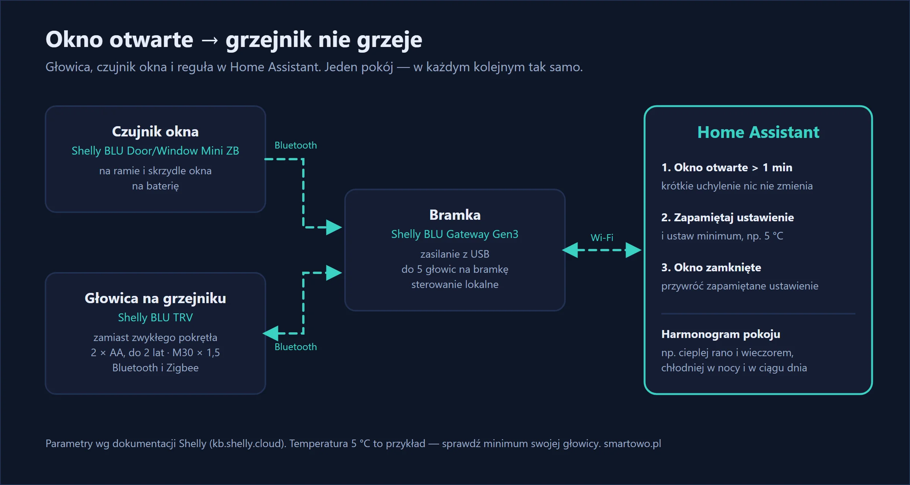
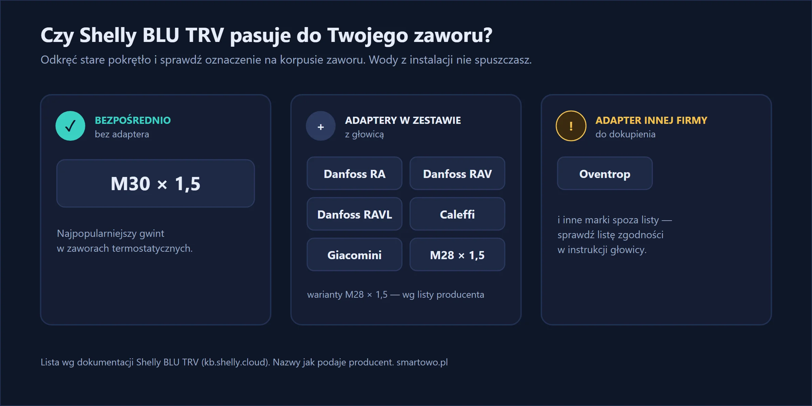
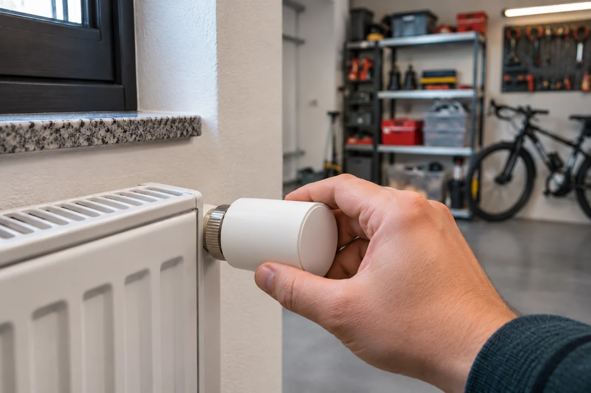
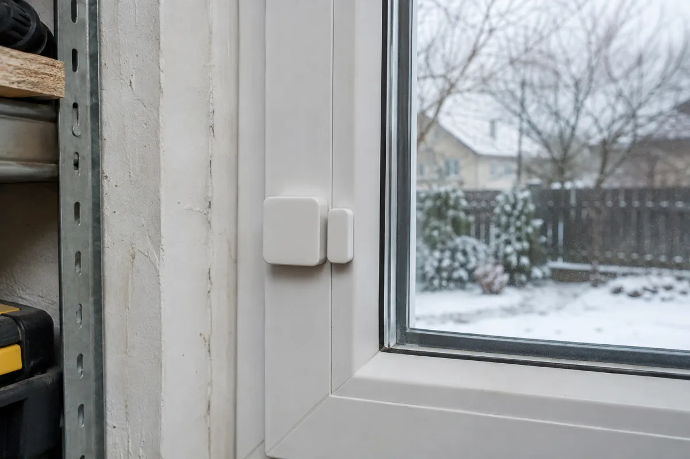

Klasyka sezonu grzewczego: otwierasz okno, żeby przewietrzyć pokój, a termostat na grzejniku „czuje” zimne powietrze i odkręca grzanie na maksimum. Ciepło ucieka przez okno, a Ty za nie płacisz.

U mnie dom grzeje pompa ciepła z podłogówką, więc głowic na grzejnikach prawie nie potrzebuję. Wyjątkiem jest garaż: jeden zwykły grzejnik, a obok drzwi, które przy noszeniu zakupów, rowerów i narzędzi potrafią stać otworem przez kwadrans. Zwykła głowica robiła wtedy dokładnie to, co opisałem wyżej — grzała na pełną moc w otwarte drzwi. Zacząłem więc od tego jednego grzejnika. Ta sama logika działa w mieszkaniu z grzejnikami pod oknami i tak ją tu opisuję.

Rozwiązanie składa się z dwóch elementów: inteligentnej głowicy termostatycznej zamiast zwykłej i małego czujnika na oknie. Gdy okno się otwiera, grzejnik przestaje grzać. Gdy się zamyka — wraca do ustawionej temperatury. Przy okazji każdy pokój dostaje własny harmonogram: cieplej, gdy jesteś w domu, chłodniej w nocy i gdy wychodzisz.

<!-- ZDJĘCIE 1: grzejnik z głowicą Shelly BLU TRV pod oknem z czujnikiem otwarcia -->

## W skrócie

- **Głowica Shelly BLU TRV** zastępuje zwykłe pokrętło termostatyczne na grzejniku — bez spuszczania wody i bez hydraulika.
- **Czujnik okna** daje znać, że okno jest otwarte. Grzejnik przestaje grzać, a po zamknięciu okna wraca do zadanej temperatury.
- **Harmonogram** dla każdego pokoju osobno: np. 21 °C rano i wieczorem, 18 °C w nocy i w ciągu dnia, gdy nikogo nie ma.
- **Home Assistant** łączy głowice, czujniki okien i harmonogramy w jedno miejsce.



{: width="1200" height="640" loading="lazy"}

## Sprzęt

Podstawą jest głowica termostatyczna. Sprzedawana jest też w zestawie z bramką, która łączy głowice z siecią Wi-Fi:



Na okno — mały czujnik otwarcia na baterię, przyklejany do ramy i skrzydła:



U mnie to jedna głowica, jedna bramka i jeden czujnik otwarcia na drzwiach garażu. Osobnego czujnika temperatury nie dokładałem — w tak małym pomieszczeniu wystarcza pomiar w samej głowicy. W mieszkaniu licz tak: jedna głowica na grzejnik, jeden czujnik na każde okno, które otwierasz do wietrzenia, i jedna bramka na maksymalnie 5 głowic.

## Czy głowica pasuje do Twojego grzejnika?

To pierwsza rzecz do sprawdzenia przed zakupem. Shelly BLU TRV ma gwint **M30 × 1,5** — najpopularniejszy w grzejnikach z zaworem termostatycznym. W zestawie są też adaptery do zaworów **Danfoss (RA, RAV, RAVL), Caleffi, Giacomini i M28 × 1,5**. Do innych zaworów (np. Oventrop) można dokupić adapter innej firmy.

{: width="1200" height="600" loading="lazy"}

Jak to sprawdzić: odkręć obecne pokrętło termostatyczne i zobacz, co jest pod spodem — producent i oznaczenie często są wybite na korpusie zaworu. Jeśli masz wątpliwości, zrób zdjęcie i porównaj z listą zgodności w instrukcji głowicy.

Mój grzejnik miał zawór z gwintem M30 × 1,5, więc głowica weszła bez adaptera.

{: width="1200" height="800" loading="lazy"}

*Ilustracja wygenerowana przez AI.*

## Montaż krok po kroku

Montaż głowicy **nie wymaga spuszczania wody z instalacji** — wymieniasz tylko pokrętło, a zawór zostaje na miejscu.

**1. Zdejmij starą głowicę.** Ustaw ją na maksimum (wtedy najłatwiej schodzi) i odkręć nakrętkę mocującą.

**2. Załóż adapter, jeśli jest potrzebny.** Przy zaworze M30 × 1,5 głowicę wkręcasz bezpośrednio.

**3. Włóż baterie i przykręć głowicę.** Głowica sama się kalibruje po zamontowaniu — przesuwa trzpień zaworu, żeby poznać jego zakres. Kalibracja nie uda się przy słabych bateriach, więc używaj nowych.

**4. Dodaj głowicę do aplikacji i do bramki.** Bramkę podłącz do zasilacza USB w miejscu, z którego „sięga” do głowic — zasięg Bluetooth w pomieszczeniu to według producenta do ok. 10 m, a ściany go skracają.

**5. Przyklej czujnik na okno.** Większa część na ramie, magnes na skrzydle — tak, żeby przy zamkniętym oknie były blisko siebie.

U mnie najwięcej czasu zajęło znalezienie miejsca na bramkę. Garaż jest za grubą ścianą i z gniazdka w korytarzu głowica raz była widoczna, a raz nie. Pomogło przeniesienie bramki do gniazdka w samym garażu — od tej pory połączenie jest stabilne.

{: width="1200" height="800" loading="lazy"}

*Ilustracja wygenerowana przez AI.*

## Wyłączanie grzania przy otwartym oknie

Producent podaje, że głowice BLU TRV współpracują z czujnikami okien z serii Shelly BLU ZB — sposób ich powiązania znajdziesz w instrukcji głowicy.

Pełną kontrolę daje reguła w Home Assistant: łatwo w niej dodać opóźnienie i przywracanie poprzedniej temperatury. U mnie robi to właśnie Home Assistant. Logika jest taka:

1. Okno jest otwarte **dłużej niż minutę** (żeby krótkie uchylenie nie przestawiało ogrzewania).
2. Home Assistant zapamiętuje aktualne ustawienie głowicy i obniża temperaturę do minimum.
3. Gdy okno się zamknie, przywraca zapamiętane ustawienie.

```yaml
- alias: "Salon – okno otwarte, nie grzej"
  triggers:
    - trigger: state
      entity_id: binary_sensor.okno_salon
      to: "on"
      for: "00:01:00"
  actions:
    - action: scene.create
      data:
        scene_id: glowica_salon_przed_wietrzeniem
        snapshot_entities:
          - climate.glowica_salon
    - action: climate.set_temperature
      target:
        entity_id: climate.glowica_salon
      data:
        temperature: 5

- alias: "Salon – okno zamknięte, wracamy do grzania"
  triggers:
    - trigger: state
      entity_id: binary_sensor.okno_salon
      to: "off"
  actions:
    - action: scene.turn_on
      target:
        entity_id: scene.glowica_salon_przed_wietrzeniem
```

Nazwy `binary_sensor.okno_salon` i `climate.glowica_salon` zmień na swoje. Temperatura 5 °C to przykład „prawie wyłączonego” grzania — sprawdź, jakie minimum przyjmuje Twoja głowica.

<!-- ZDJĘCIE 4: zrzut ekranu Home Assistant — karta termostatu i stan okna -->

## Harmonogram dla każdego pokoju

Wyłączanie przy wietrzeniu to jedno, ale w praktyce równie ważny jest harmonogram. Typowy przykład:

- **sypialnia** — chłodniej w nocy, cieplej na pół godziny przed pobudką,
- **salon** — cieplej rano i wieczorem, chłodniej w ciągu dnia, gdy wszyscy są w pracy,
- **łazienka** — cieplej rano przed prysznicem.

U mnie harmonogram jest prosty, bo to garaż: 16 °C w dzień, kiedy się tam kręcę, i 10 °C w nocy. W mieszkaniu warto zacząć od 21 °C rano i wieczorem, 19 °C w ciągu dnia i 18 °C w nocy, a po tygodniu poprawić według tego, co mówią domownicy.



## Ile to kosztuje

Mój zestaw to głowica z bramką i jeden czujnik otwarcia — razem około 500 zł. Montaż z konfiguracją zajął niecałą godzinę, z czego większość to szukanie miejsca na bramkę i pisanie automatyzacji. Każdy kolejny grzejnik to następna głowica i czujnik; bramka wystarcza na pięć głowic.

Inteligentne głowice z czujnikami są w pakiecie Komfort — zobacz [cennik](/#cennik).

## Efekt po kilku tygodniach

Po kilku tygodniach wygląda to tak: głowica zamyka zawór mniej więcej minutę po otwarciu drzwi i otwiera go zaraz po ich zamknięciu — widzę to na wykresie położenia zaworu w Home Assistant. Rachunków nie porównuję, bo jeden grzejnik w garażu ginie w zużyciu całego domu, a nie będę udawał, że mam tu twarde liczby. Jedną rzecz musiałem poprawić: na początku nie miałem minuty opóźnienia i grzejnik przestawiał się przy każdym wejściu do garażu.

## Najczęstsze pytania

**Czy do montażu głowicy trzeba spuszczać wodę z grzejnika?**
Nie. Wymieniasz tylko pokrętło termostatyczne, a zawór grzejnika zostaje na miejscu. Instalacja grzewcza pozostaje szczelna.

**Czy Shelly BLU TRV pasuje do mojego grzejnika?**
Głowica ma gwint M30 × 1,5, a w zestawie są adaptery do zaworów Danfoss (RA, RAV, RAVL), Caleffi, Giacomini i M28 × 1,5. Do innych zaworów potrzebny jest dodatkowy adapter.

**Na ile wystarczą baterie w głowicy?**
Głowica działa na 2 baterie AA, które według producenta wystarczają do 2 lat. Poziom baterii widać w aplikacji.

**Czy głowice działają bez internetu?**
Bramka BLU Gateway Gen3 pozwala sterować głowicami lokalnie, w sieci domowej. Internet jest potrzebny tylko do sterowania spoza domu przez chmurę Shelly.
