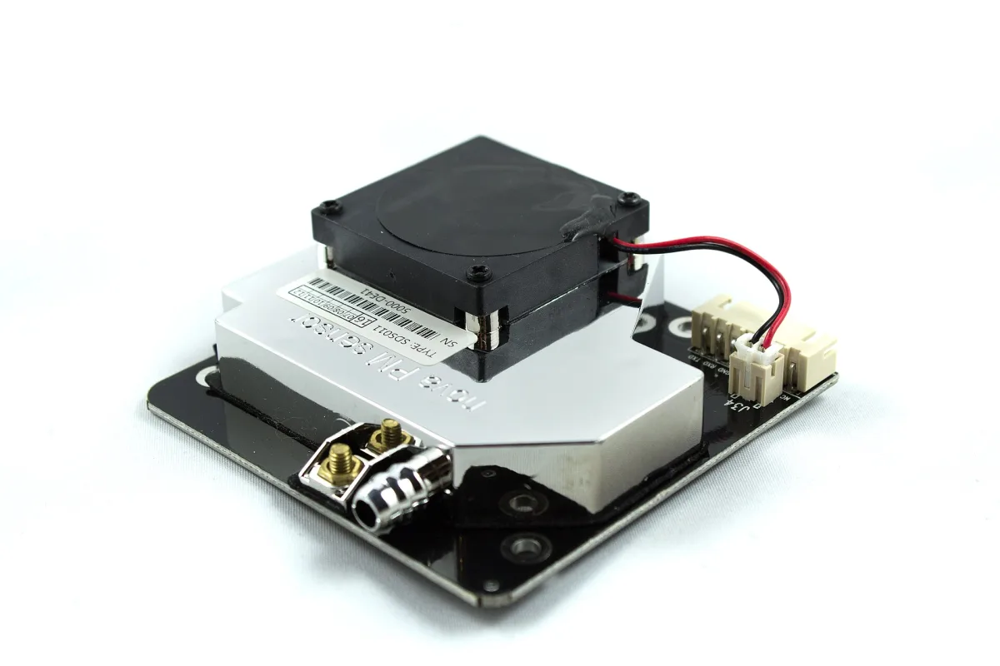
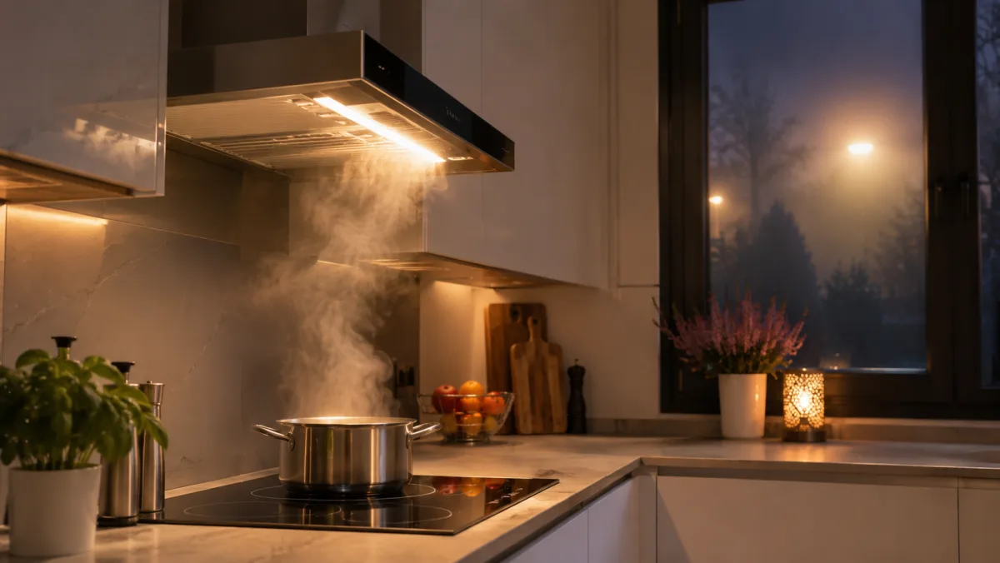
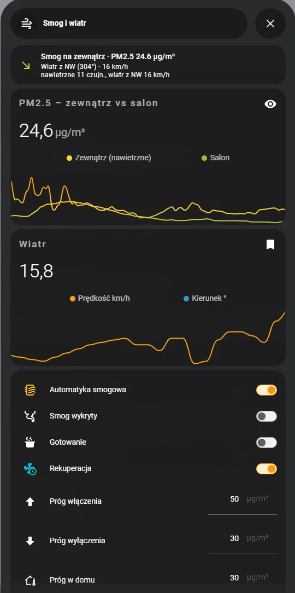

Rekuperator ma jedną wadę, o której mało kto mówi przy zakupie: pracuje bez przerwy, więc w smogowy wieczór równie pilnie wciąga do domu to, co sąsiedzi wypuszczają z kominów. Filtry część zatrzymują, ale nie wszystko.

Zauważyłem to w poprzednim sezonie grzewczym: w domu poczułem zapach dymu, a czujnik powietrza w salonie pokazał to samo, co nos. Nie mam w centrali niczego nietypowego — standardowe filtry do rekuperatora, wymieniane regularnie. Na smogowy wieczór to po prostu za mało.

U siebie rozwiązałem to automatyzacją w Home Assistant. Gdy powietrze na zewnątrz jest brudne **i** czujnik w salonie pokazuje, że w domu też robi się brudno, rekuperacja przechodzi w tryb czuwania. Kiedy smog mija, wraca do trybu, w którym była wcześniej. Dostaję o tym powiadomienie na telefon i nie muszę niczego klikać.

{: width="1200" height="800" loading="lazy"}

*Tak wygląda smogowy wieczór z góry — tu akurat Kraków. Fot. Andrzej Kamiński, [Wikimedia Commons](https://commons.wikimedia.org/wiki/File:Smog_in_Cracow_01.jpg), [CC BY-SA 4.0](https://creativecommons.org/licenses/by-sa/4.0/deed.pl).*

## W skrócie

- **Powietrze na zewnątrz** sprawdzam z publicznych czujników Sensor.Community — biorę te, które stoją od strony, z której akurat wieje wiatr.
- **Powietrze w domu** mierzy czujnik Qingping Air Monitor Lite w salonie (PM2.5 i CO2).
- **Home Assistant** wstrzymuje rekuperację dopiero wtedy, gdy brudno jest i na zewnątrz, i w środku.
- **Gotowanie ma pierwszeństwo** — gdy pracuje okap, wentylacja wraca mimo smogu.
- **Bezpiecznik**: jeśli w czasie postoju rośnie CO2 albo postój trwa ponad 8 godzin, dostaję powiadomienie.

{: width="1200" height="680" loading="lazy"}



## Czego użyłem

- **Rekuperator Viessmann Vitovent 300-W** podłączony do Home Assistant przez oficjalną integrację ViCare. W Home Assistant widać go jako wentylator z trzema trybami: `ventilation`, `standard` i `standby`.
- **Qingping Air Monitor Lite** w salonie — mierzy PM2.5, PM10, CO2, temperaturę i wilgotność. U mnie jest dodany do Home Assistant przez HomeKit, więc działa lokalnie.
- **Czujniki Sensor.Community** — sieć amatorskich czujników powietrza z publicznymi odczytami. Home Assistant ma do nich gotową integrację; mam dodanych 31 czujników z okolicy.
- **Gniazdko z pomiarem mocy na okapie** — u mnie Shelly Plug S Gen3. Niczego nie przełącza, tylko mierzy, czy okap pracuje.



Nie masz rekuperatora Viessmann? Logika zostaje ta sama. Potrzebujesz tylko centrali, którą da się z Home Assistant przełączyć w tryb postoju albo najniższy bieg.

## Jak podłączyłem rekuperator do Home Assistant

Vitovent nie wymagał żadnego dodatkowego sprzętu ani kabli. Skoro widać go w aplikacji ViCare, to Home Assistant dostaje się do niego tą samą drogą — przez chmurę Viessmanna. Konfiguracja wygląda tak:

1. Logujesz się do **portalu deweloperskiego Viessmann** tym samym kontem, którego używasz w aplikacji ViCare.
2. W sekcji „Clients” dodajesz nowego klienta: nazwa dowolna (np. HomeAssistant), **Google reCAPTCHA wyłączone**, adres przekierowania `https://my.home-assistant.io/redirect/oauth`.
3. Kopiujesz **Client ID**. Nowy klient potrafi zacząć działać dopiero po godzinie, więc nie panikuj, jeśli od razu nie przejdzie.
4. W Home Assistant dodajesz integrację **Viessmann ViCare** i wklejasz Client ID. Pole „Client Secret” możesz wypełnić czymkolwiek — integracja go nie używa.
5. Logujesz się kontem ViCare i gotowe: rekuperator pojawia się jako wentylator.

Dwie rzeczy warto wiedzieć, zanim oprzesz na tym automatyzację:

- **To integracja chmurowa.** Home Assistant odpytuje serwery Viessmanna co 60 sekund. Bez internetu albo przy awarii po stronie Viessmanna rekuperatorem nie posterujesz. Dlatego moja automatyzacja nic nie robi, gdy rekuperator jest niedostępny.
- **Darmowe konto ma limit zapytań**: 120 na 10 minut i 1450 na dobę. Po przekroczeniu dostęp jest blokowany na 24 godziny. Zwykłe odpytywanie mieści się w limicie, ale każda zmiana trybu i każde otwarcie aplikacji ViCare też się liczy — to kolejny powód, żeby rekuperacja nie przełączała się co chwilę.

## Skąd wiem, że na zewnątrz jest smog

Jeden czujnik to za mało. Publiczne czujniki potrafią pokazywać głupoty, a pojedynczy komin obok jednego z nich zawyża odczyt dla całej okolicy. Dlatego zrobiłem w Home Assistant własny czujnik „PM2.5 zewnątrz”, który:

1. bierze odczyty z czujników Sensor.Community w okolicy,
2. zostawia tylko te **po stronie nawietrznej** — czyli tam, skąd wiatr niesie powietrze w moją stronę,
3. liczy z nich **medianę**, więc jeden zwariowany czujnik niczego nie psuje,
4. przy bezwietrznej pogodzie bierze medianę ze wszystkich.

{: width="1200" height="680" loading="lazy"}

{: width="1200" height="800" loading="lazy"}

*Czujnik pyłu SDS011 — taki pracuje w wielu amatorskich stacjach sieci Sensor.Community. Fot. ubahnverleih, [Wikimedia Commons](https://commons.wikimedia.org/wiki/File:Feinstaubsensor_SDS011.jpg), CC0.*

Obok mam drugi czujnik tekstowy, który mówi, skąd wziął się wynik, na przykład: „nawietrzne 12 czujn., wiatr z NW 14 km/h”. Ten opis trafia potem do powiadomienia.

Kierunek i prędkość wiatru biorę z integracji pogody w Home Assistant, a czujniki — z promienia 10 km od domu. To daje wystarczająco dużo punktów, żeby po odrzuceniu tych „z tyłu” wciąż było z czego liczyć medianę.

## Automatyzacja 1: wykrywanie smogu

Pierwsza automatyzacja niczym nie steruje. Ustawia tylko przełącznik pomocniczy „smog” — dzięki temu resztę logiki pisze się prosto.

Smog zaczyna się, gdy PM2.5 na zewnątrz przekracza **50 µg/m³ przez 15 minut**. Kończy się, gdy spadnie poniżej **30 µg/m³ na 15 minut**. Dwa różne progi i czas oczekiwania są po to, żeby rekuperacja nie włączała się i nie wyłączała co chwilę, gdy odczyt skacze wokół jednej wartości.

```yaml
- alias: "Wentylacja – wykrywanie smogu"
  triggers:
    - trigger: numeric_state
      entity_id: sensor.pm2_5_zewnatrz
      above: input_number.smog_prog_wlaczenia
      for: "00:15:00"
      id: smog_on
    - trigger: numeric_state
      entity_id: sensor.pm2_5_zewnatrz
      below: input_number.smog_prog_wylaczenia
      for: "00:15:00"
      id: smog_off
  actions:
    - choose:
        - conditions:
            - condition: trigger
              id: smog_on
          sequence:
            - action: input_boolean.turn_on
              target:
                entity_id: input_boolean.wentylacja_smog
        - conditions:
            - condition: trigger
              id: smog_off
          sequence:
            - action: input_boolean.turn_off
              target:
                entity_id: input_boolean.wentylacja_smog
```

Progi trzymam w pomocnikach (`input_number`), więc zmieniam je z panelu, bez grzebania w automatyzacji.

## Automatyzacja 2: wykrywanie gotowania

Podczas gotowania wentylacja jest potrzebna bardziej niż kiedykolwiek, więc smog nie może jej wtedy blokować. Gotowanie rozpoznaję po okapie: samo światło okapu bierze u mnie 3–4 W, a nawiew 220–250 W. Próg ustawiłem na **100 W przez 30 sekund**.

Koniec gotowania liczę dopiero **20 minut po wyłączeniu nawiewu**, bo para i zapach wiszą w powietrzu jeszcze długo po zdjęciu garnka.

{: width="1200" height="676" loading="lazy"}

*Ilustracja wygenerowana przez AI — to nie jest moja kuchnia.*

```yaml
- alias: "Wentylacja – wykrywanie gotowania"
  triggers:
    - trigger: numeric_state
      entity_id: sensor.kuchnia_pochlaniacz_power
      above: 100
      for: "00:00:30"
      id: start
    - trigger: numeric_state
      entity_id: sensor.kuchnia_pochlaniacz_power
      below: 100
      for: "00:20:00"
      id: stop
  actions:
    - choose:
        - conditions:
            - condition: trigger
              id: start
          sequence:
            - action: input_boolean.turn_on
              target:
                entity_id: input_boolean.wentylacja_gotowanie
        - conditions:
            - condition: trigger
              id: stop
          sequence:
            - action: input_boolean.turn_off
              target:
                entity_id: input_boolean.wentylacja_gotowanie
```

## Automatyzacja 3: sterowanie rekuperacją

To jest właściwa decyzja. Zasady są cztery:

1. **Smog na zewnątrz i brudno w domu** (PM2.5 w salonie od 30 µg/m³ w górę) → zapamiętaj aktualny tryb i ustaw `standby`.
2. **Smog na zewnątrz, ale w domu czysto** → wentyluj dalej. Skoro filtry dają radę, nie ma powodu dusić domu.
3. **Gotowanie** → wentylacja wraca, nawet przy smogu.
4. **Smog minął** → przywróć zapamiętany tryb.

Kilka szczegółów, które wyszły w praniu:

- Zmiana odczytu w domu liczy się dopiero po **5 minutach** stabilnego wyniku.
- Gdy czujnik w salonie jest niedostępny, automatyzacja zakłada, że w domu jest brudno. Wolę niepotrzebny postój niż wciąganie smogu.
- Gdy niedostępny jest sam rekuperator, automatyzacja nic nie robi.
- Całość ma jeden wyłącznik (`input_boolean.wentylacja_auto_smog`) — przydaje się, gdy chcę przez chwilę sterować ręcznie.


```yaml
- alias: "Wentylacja – sterowanie rekuperacją"
  mode: queued
  max: 5
  variables:
    fan: fan.rekuperator
    czujnik_dom: sensor.qingping_air_monitor_lite_pm2_5_density
    smog: "{{ is_state('input_boolean.wentylacja_smog', 'on') }}"
    gotowanie: "{{ is_state('input_boolean.wentylacja_gotowanie', 'on') }}"
    aktualny: "{{ state_attr(fan, 'preset_mode') }}"
    zapamietany: "{{ states('input_select.wentylacja_tryb_zapamietany') }}"
    pm_zewn: "{{ states('sensor.pm2_5_zewnatrz') }}"
    pm_wewn: "{{ states(czujnik_dom) }}"
    wewn_czysto: >-
      {{ states(czujnik_dom) | float(999)
         < states('input_number.smog_prog_wewnatrz') | float(30) }}
  triggers:
    - trigger: state
      entity_id:
        - input_boolean.wentylacja_smog
        - input_boolean.wentylacja_gotowanie
    - trigger: state
      entity_id: input_boolean.wentylacja_auto_smog
      to: "on"
    - trigger: homeassistant
      event: start
    - trigger: template
      value_template: >-
        {{ states('sensor.qingping_air_monitor_lite_pm2_5_density') | float(999)
           < states('input_number.smog_prog_wewnatrz') | float(30) }}
      for: "00:05:00"
      id: wewn_czysto
    - trigger: template
      value_template: >-
        {{ states('sensor.qingping_air_monitor_lite_pm2_5_density') | float(999)
           >= states('input_number.smog_prog_wewnatrz') | float(30) }}
      for: "00:05:00"
      id: wewn_brudno
  conditions:
    - condition: state
      entity_id: input_boolean.wentylacja_auto_smog
      state: "on"
    - condition: not
      conditions:
        - condition: state
          entity_id: fan.rekuperator
          state: unavailable
    # Zmiany czujnika w domu liczą się tylko podczas smogu
    - condition: template
      value_template: >-
        {{ (trigger.id | default('')) not in ['wewn_czysto', 'wewn_brudno']
           or is_state('input_boolean.wentylacja_smog', 'on') }}
  actions:
    - choose:
        # Smog, w domu brudno i nie gotujemy → standby
        - conditions:
            - condition: template
              value_template: "{{ smog and not gotowanie and not wewn_czysto }}"
          sequence:
            - if:
                - condition: template
                  value_template: "{{ aktualny in ['ventilation', 'standard'] }}"
              then:
                - action: input_select.select_option
                  target:
                    entity_id: input_select.wentylacja_tryb_zapamietany
                  data:
                    option: "{{ aktualny }}"
                - action: fan.set_preset_mode
                  target:
                    entity_id: "{{ fan }}"
                  data:
                    preset_mode: standby
                - action: notify.mobile_app_twoj_telefon
                  data:
                    title: "Smog"
                    message: >-
                      PM2.5 na zewnątrz {{ pm_zewn }} µg/m³, w domu {{ pm_wewn }} µg/m³
                      – rekuperacja w standby.
        # Brak smogu, czysto w domu lub gotowanie → przywróć tryb
        - conditions:
            - condition: template
              value_template: "{{ aktualny == 'standby' }}"
          sequence:
            - action: fan.set_preset_mode
              target:
                entity_id: "{{ fan }}"
              data:
                preset_mode: "{{ zapamietany }}"
            - action: notify.mobile_app_twoj_telefon
              data:
                title: "Rekuperacja włączona"
                message: >-
                  Gotowanie – wentylacja włączona mimo smogu.
                  W domu czysto ({{ pm_wewn }} µg/m³) – wentylacja włączona mimo smogu.
                  Powietrze na zewnątrz OK ({{ pm_zewn }} µg/m³) – przywrócono tryb {{ zapamietany }}.
                  
```


Nazwy `fan.rekuperator`, `sensor.qingping_…` i `notify.mobile_app_twoj_telefon` zamień na swoje encje. Nazwy trybów (`ventilation`, `standard`, `standby`) pochodzą z integracji ViCare — inna centrala może mieć inne.

Żeby to zadziałało, potrzebujesz jeszcze pomocników: trzech przełączników (`input_boolean`: smog, gotowanie, wyłącznik całości), trzech progów (`input_number`) i listy wyboru (`input_select`) z trybami `ventilation` i `standard`, w której automatyzacja zapamiętuje tryb sprzed postoju.

Wszystko to mam na jednej karcie w Home Assistant: aktualny odczyt z zewnątrz ze źródłem, wykres „zewnątrz kontra salon”, wiatr, przełączniki i trzy progi.

{: width="400" height="803" loading="lazy"}

## Automatyzacja 4: bezpiecznik na CO2

Wstrzymana wentylacja to dom bez świeżego powietrza. Przy kilku osobach w środku CO2 rośnie szybko, dlatego ostatnia automatyzacja pilnuje, żeby postój nie trwał w nieskończoność. Niczego nie przełącza — wysyła tylko powiadomienie, gdy rekuperacja stoi, a:

- CO2 w salonie przekracza **1200 ppm przez 10 minut**, albo
- postój trwa już **ponad 8 godzin**.

W powiadomieniu jest aktualny odczyt z zewnątrz, więc od razu wiem, czy lepiej na chwilę uchylić okno, czy ręcznie włączyć wentylację.


```yaml
- alias: "Wentylacja – alert CO2 przy standby"
  triggers:
    - trigger: numeric_state
      entity_id: sensor.qingping_air_monitor_lite_co2_carbon_dioxide
      above: 1200
      for: "00:10:00"
      id: co2
    - trigger: template
      value_template: "{{ state_attr('fan.rekuperator', 'preset_mode') == 'standby' }}"
      for: "08:00:00"
      id: dlugo
  conditions:
    - condition: template
      value_template: "{{ state_attr('fan.rekuperator', 'preset_mode') == 'standby' }}"
  actions:
    - action: notify.mobile_app_twoj_telefon
      data:
        title: "Rekuperacja w standby"
        message: >-
          CO2 w salonie
          {{ states('sensor.qingping_air_monitor_lite_co2_carbon_dioxide') | int }} ppm
          Standby trwa już ponad 8 h.
          PM2.5 zewn. {{ states('sensor.pm2_5_zewnatrz') }} µg/m³ – rozważ krótkie przewietrzenie.
```




## Ile to kosztuje

Rekuperator i Home Assistant już miałem. Dokupić trzeba było czujnik powietrza do salonu i gniazdko z pomiarem mocy na okap. Odczyty z Sensor.Community są darmowe.

- Qingping Air Monitor Lite: **315 zł**
- gniazdko Shelly z pomiarem mocy: **około 110 zł**

Razem około 425 zł. Dopracowanie progów zajęło mi jeden wieczór — akurat ten smogowy, który opisuję niżej.

## Jak to działa w praktyce: pierwszy smogowy wieczór

Najlepiej pokazać to na logach z Home Assistant. W poniedziałek 9 listopada rekuperacja zatrzymała się dwa razy.

**17:53 — pierwszy postój.** Jeszcze o 17:00 na zewnątrz było 18 µg/m³. Pół godziny później już 30, a o 17:38 czujniki pokazały szczyt wieczoru: 68 µg/m³. Po 15 minutach powyżej progu automatyzacja uznała, że to smog, i minutę później rekuperator przeszedł w standby. Stał do 19:08, czyli godzinę i kwadrans.

**19:08 — poprawka i wentylacja wraca mimo smogu.** Na zewnątrz wciąż było ponad 40 µg/m³, ale czujnik w salonie pokazywał 18 — tyle samo co przed smogiem. Rekuperator stał więc od ponad godziny bez potrzeby. Pierwsza wersja automatyzacji patrzyła tylko na powietrze za oknem, dlatego około 19:00 dopisałem warunek czujnika w domu: „w domu czysto → wentyluj dalej”. Po zapisaniu zmiany wentylacja od razu wróciła.

**21:04 — drugi postój, już według nowej reguły.** Przez kolejne dwie godziny na zewnątrz było od 37 do 60 µg/m³, a w salonie odczyt powoli rósł: 22 o 19:30, 25 o 20:00, 29 o 20:12, aż o 21:03 przekroczył próg 30. Rekuperator znów przeszedł w standby.

**21:24 — koniec smogu.** Na zewnątrz spadło do 26 µg/m³, automatyzacja odwołała smog i przywróciła wentylację. Drugi postój trwał 20 minut.

Co z tego wynika:

- **Sam czujnik zewnętrzny to za mało.** Pierwszy postój był niepotrzebny, bo w domu było czysto. Dopiero warunek czujnika w salonie sprawił, że rekuperacja staje wtedy, kiedy naprawdę trzeba — drugi postój i powrót odbyły się już bez mojego udziału.
- **CO2 nie zdążyło urosnąć.** Przez cały wieczór w salonie było najwyżej 665 ppm, więc alert CO2 się nie odezwał.
- **Filtry nie zatrzymują wszystkiego.** Przy pracującej wentylacji i 40–60 µg/m³ na zewnątrz odczyt w salonie wzrósł w dwie godziny z 18 do 31. To najlepszy argument za tym, żeby patrzeć na czujnik w domu, a nie tylko na ten za oknem.
- **Jeden wieczór to za mało na wnioski o skuteczności.** Po 21:24 w salonie zostało około 30 µg/m³ do końca wieczoru, mimo że na zewnątrz było już podobnie. Czy dłuższy postój dałby lepszy wynik — sprawdzę przy kolejnych epizodach i dopiszę tutaj.

## Najczęstsze pytania

**Czy rekuperacja wciąga smog do domu?**
Wciąga powietrze z zewnątrz przez filtry. Ile pyłu przejdzie, zależy od klasy filtrów i ich stanu — najprościej sprawdzić to czujnikiem PM2.5 postawionym w domu. Ja właśnie na jego odczycie opieram decyzję o postoju.

**Czy wyłączać rekuperację podczas smogu?**
Na krótko i z głową. Bez wentylacji w domu rośnie CO2 i wilgotność, dlatego u mnie postój włącza się tylko wtedy, gdy w domu faktycznie robi się brudno, a osobna automatyzacja pilnuje CO2 i czasu postoju.

**Skąd wziąć dane o smogu do Home Assistant?**
Ja korzystam z Sensor.Community — sieci amatorskich czujników z publicznymi odczytami i gotową integracją w Home Assistant. Warto dodać kilka czujników z okolicy i liczyć z nich medianę zamiast ufać jednemu.

**Czy to zadziała z rekuperatorem innej marki?**
Tak, jeśli centralę da się z Home Assistant przełączyć w tryb postoju albo na najniższy bieg. Zmieniają się tylko nazwy trybów w automatyzacji.
