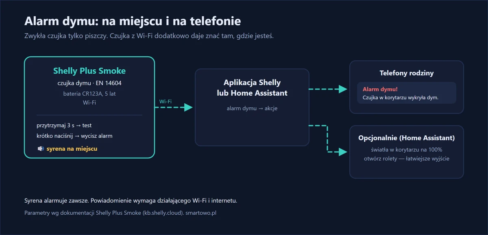
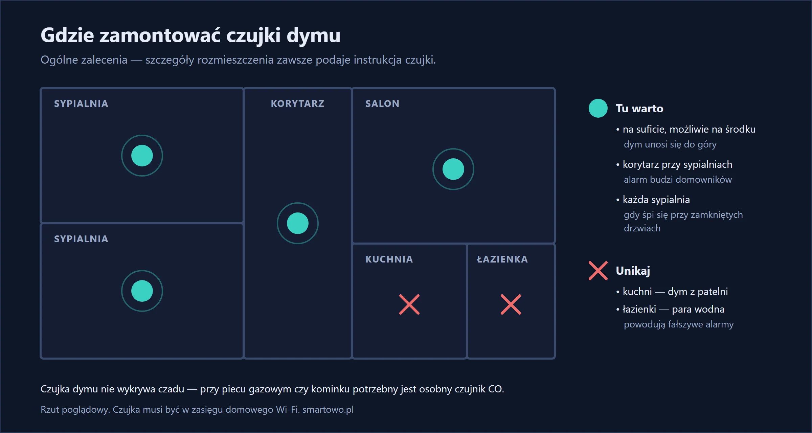
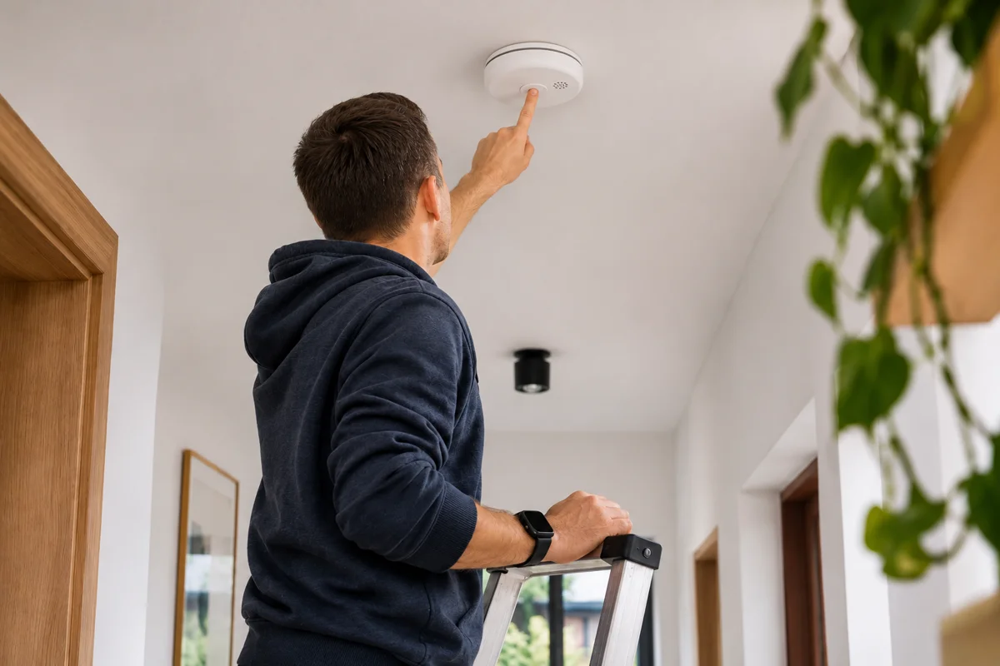

Zwykła czujka dymu ma jedną wadę: alarmuje tylko tam, gdzie wisi. Jeśli nikogo nie ma w domu — nikt jej nie usłyszy. Jeśli w mieszkaniu jest starsza osoba, która słabo słyszy albo mocno śpi — syrena może nie wystarczyć.

Montowałem takie czujki w mieszkaniu starszego małżeństwa we Wrocławiu, na zlecenie ich syna: dwa pokoje, oboje śpią przy zamkniętych drzwiach, a zwykła czujka wisiała tam od lat i nikt nie pamiętał, kiedy ostatnio wymieniano w niej baterię. Chodziło o to, żeby o alarmie wiedział także ktoś spoza mieszkania.

Czujka dymu z Wi-Fi robi to samo co zwykła — **głośno alarmuje na miejscu** — ale dodatkowo **wysyła powiadomienie na telefon**. Możesz od razu zadzwonić do rodziców albo sąsiada, zanim zrobi się naprawdę groźnie.

<!-- ZDJĘCIE 1: czujka dymu na suficie -->

## W skrócie

- **Shelly Plus Smoke** to czujka dymu zgodna z normą **EN 14604** — tą samą, którą spełniają zwykłe czujki domowe.
- Alarmuje **syreną na miejscu** i wysyła **powiadomienie na telefon** przez Wi-Fi.
- Działa na **baterii CR123A** — według producenta na **5 lat**. Bez kabli i bez prac elektrycznych.
- W Home Assistant alarm może dodatkowo np. **zapalić światła** na drodze ewakuacji.



{: width="1200" height="580" loading="lazy"}

## Sprzęt



W tej realizacji zawisły dwie czujki: jedna w korytarzu przy sypialni, druga w salonie.

Ważne: to **czujka dymu, nie czujnik czadu**. Jeśli w domu jest piec gazowy, kominek albo piecyk, potrzebny jest też osobny czujnik tlenku węgla (czadu).

## Gdzie zamontować czujkę

Szczegółowe zasady rozmieszczenia zawsze podaje instrukcja czujki — trzymaj się jej. Ogólne zalecenia dla czujek dymu są takie:

- **na suficie**, możliwie na środku pomieszczenia — dym unosi się do góry,
- **w korytarzu przy sypialniach** — żeby alarm obudził domowników,
- **w każdej sypialni**, jeśli ktoś śpi przy zamkniętych drzwiach,
- **z dala od kuchenki i łazienki** — para i dym z patelni powodują fałszywe alarmy.

{: width="1200" height="640" loading="lazy"}

Czujka łączy się z Wi-Fi, więc w miejscu montażu musi być zasięg domowej sieci.

Tutaj: korytarz przy drzwiach sypialni i środek sufitu w salonie. Kuchnię celowo pominąłem — dym z kuchni i tak najpierw trafi do korytarza, a fałszywych alarmów przy smażeniu nikt nie chce.

{: width="1200" height="800" loading="lazy"}

*Ilustracja wygenerowana przez AI.*

## Montaż krok po kroku

**1. Włóż baterię i dodaj czujkę do aplikacji Shelly.** Czujka łączy się z domową siecią Wi-Fi.

**2. Przykręć podstawę do sufitu** i wkręć w nią czujkę.

**3. Przetestuj.** Przytrzymaj przycisk przez 3 sekundy — czujka mignie i zapiszczy. Sprawdź, czy powiadomienie dotarło na telefon.

**4. Wyciszanie.** Krótkie naciśnięcie przycisku wycisza trwający alarm — przydatne, gdy wiesz, że to tylko przypalona grzanka.

Sam montaż to dwa kołki na czujkę. Trudniejsze było Wi-Fi: router stał w salonie i w korytarzu sygnał był na granicy, więc przed wierceniem przyłożyłem czujkę do sufitu i sprawdziłem siłę sygnału w aplikacji. Druga rzecz to test — syrena jest naprawdę głośna, więc uprzedź domowników.

## Powiadomienia i automatyzacje

W aplikacji Shelly ustawiasz powiadomienie o alarmie dymowym. W Home Assistant możesz dodać więcej akcji — np. zapalić światła w korytarzu i wysłać wiadomość do całej rodziny:

```yaml
- alias: "Alarm dymu"
  triggers:
    - trigger: state
      entity_id: binary_sensor.czujka_dymu_korytarz_smoke
      to: "on"
  actions:
    - action: light.turn_on
      target:
        entity_id: light.korytarz
      data:
        brightness_pct: 100
    - action: notify.mobile_app_twoj_telefon
      data:
        title: "Alarm dymu!"
        message: "Czujka w korytarzu wykryła dym."
```

Nazwy encji zmień na swoje. Jeśli masz rolety sterowane przez Home Assistant, w tej samej automatyzacji możesz je otworzyć — to ułatwia wyjście z domu.



## Ile to kosztuje

Dwie czujki to około 400–450 zł. Montaż i konfiguracja obu, razem z testami, zajęły mi niecałą godzinę.

Czujka dymu jest częścią pakietu [Bezpieczny Senior](/senior/) — razem z czujnikami zalania, czujnikiem drzwi i alertem braku ruchu rano.

## Efekt po kilku tygodniach

Przez pierwsze tygodnie nie było ani jednego fałszywego alarmu. Powiadomienie testowe dochodzi na telefon syna po kilku sekundach — umówiliśmy się, że sprawdza to raz w miesiącu. Domownicy mówią, że największa zmiana to spokój: wiedzą, że jeśli coś się stanie w nocy, sygnał dostanie jeszcze ktoś.

## Najczęstsze pytania

**Czy czujka dymu z Wi-Fi działa bez internetu?**
Syrena alarmuje na miejscu zawsze. Powiadomienie na telefon wymaga działającego Wi-Fi i internetu — przez chmurę Shelly albo przez Home Assistant z dostępem zdalnym.

**Czy Shelly Plus Smoke wykrywa czad?**
Nie. To czujka dymu. Do wykrywania tlenku węgla (czadu) potrzebny jest osobny czujnik CO.

**Na ile wystarcza bateria?**
Według producenta oryginalna bateria CR123A wystarcza na 5 lat.

**Jak wyciszyć fałszywy alarm?**
Krótkie naciśnięcie przycisku na czujce wycisza trwający alarm. Przytrzymanie przycisku przez 3 sekundy uruchamia test.
