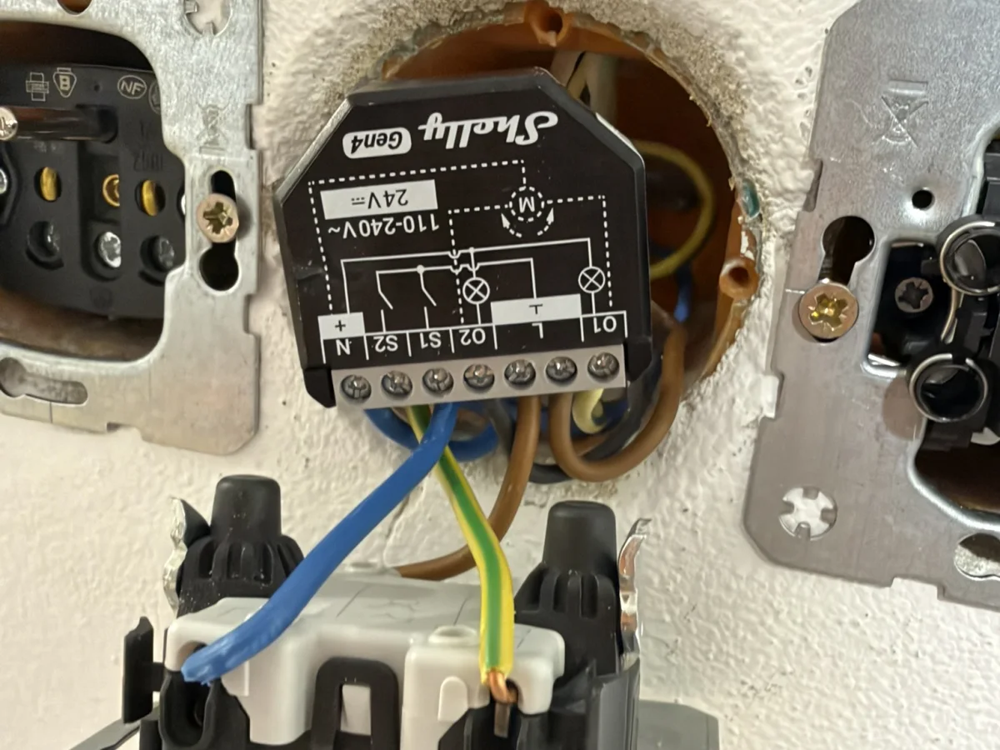
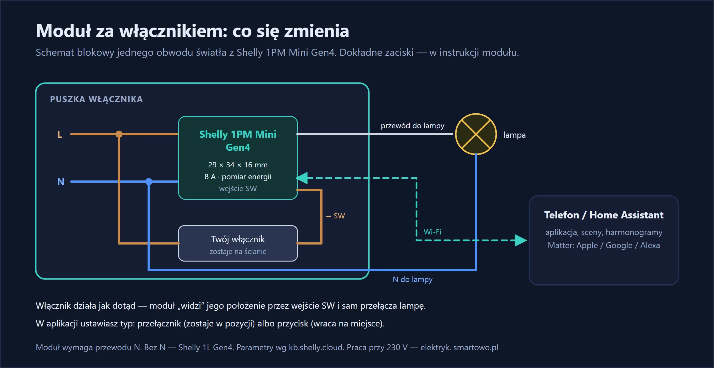
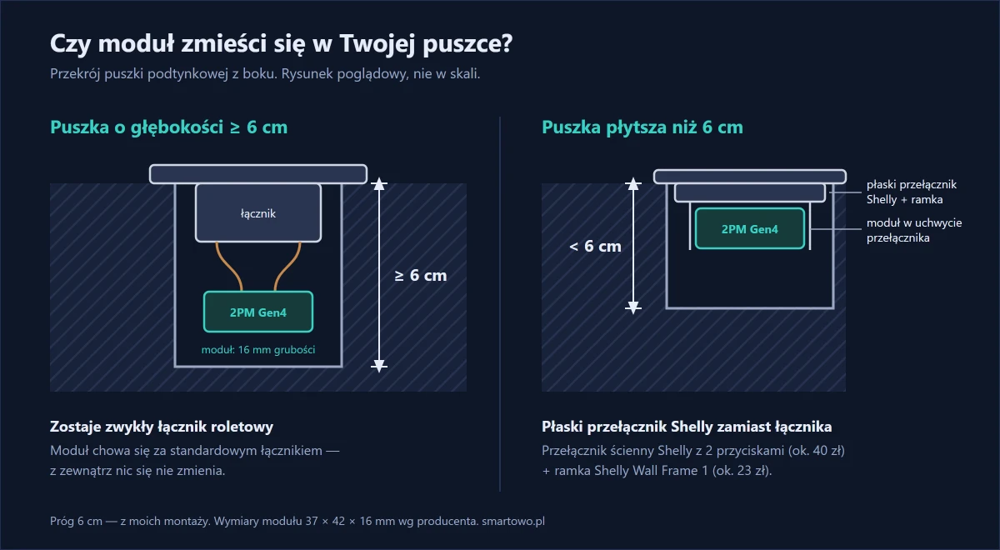
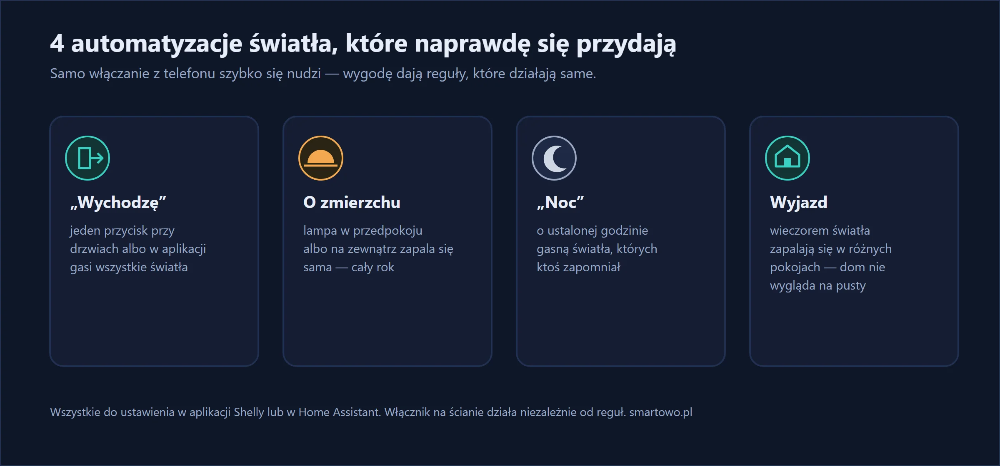

Wychodzisz z domu i w połowie drogi zastanawiasz się, czy zgasiło się światło w łazience. Albo wieczorem obchodzisz cały dom, żeby wszystko powyłączać. Albo po prostu chcesz, żeby lampa w przedpokoju zapalała się sama o zmierzchu.

U siebie zacząłem od sypialni: jeden obwód światła i odwieczny problem, że włącznik jest przy drzwiach, a nie przy łóżku.

Nie trzeba do tego wymieniać włączników na „smart” ani kuć ścian. Za każdym zwykłym włącznikiem, w tej samej puszce, chowa się mały moduł. Włącznik działa jak dotąd, a dodatkowo światłem sterujesz z telefonu i automatyzacjami.

{: width="1200" height="900" loading="lazy"}

*Tak wygląda moduł w puszce. Na zdjęciu większy Shelly 2PM Gen4 z mojego [montażu rolet](/blog/sterowanie-roletami-z-telefonu-shelly-2pm/) — 1PM Mini do światła jest jeszcze mniejszy.*

## W skrócie

- **Shelly 1PM Mini Gen4** mieści się w puszce za zwykłym włącznikiem — ma 29 × 34 × 16 mm.
- **Twoje włączniki zostają** i działają jak dotąd — moduł podłącza się do nich przewodami.
- Światłem sterujesz **z telefonu**, ustawiasz **harmonogramy** i **sceny** (np. „wyłącz wszystko” przy wyjściu).
- Moduł **mierzy zużycie energii** i obsługuje **Matter**, więc działa z Apple Home, Google Home i Alexą.
- Wymaga **przewodu neutralnego** w puszce. Jeśli go nie ma — zobacz moduły bez neutralnego (Shelly 1L/2L).



{: width="1200" height="620" loading="lazy"}

## Sprzęt



Jeden moduł steruje jednym obwodem światła. Do włącznika świecznikowego (dwa obwody) potrzebne są dwa moduły albo moduł dwukanałowy.

Jeśli po podłączeniu żarówki LED lekko migają albo żarzą się po wyłączeniu, pomaga tłumik zakłóceń montowany przy lampie:



W sypialni mam jeden moduł za włącznikiem. Tłumik nie był potrzebny — lampy LED nie migały ani się nie żarzyły.

## Montaż krok po kroku

> **Uwaga:** montaż wymaga pracy przy instalacji 230 V. Jeśli nie masz uprawnień elektrycznych, zleć go elektrykowi — albo [napisz do mnie](#kontakt), zrobię to za Ciebie.

**1. Wyłącz bezpiecznik** obwodu oświetlenia i sprawdź próbnikiem brak napięcia.

**2. Sprawdź puszkę.** Potrzebujesz fazy (L), przewodu neutralnego (N) i przewodu do lampy. Bez przewodu N ten moduł nie zadziała.

**3. Podłącz moduł:** L i N do zacisków zasilania, przewód do lampy do wyjścia, a włącznik między fazę a wejście SW modułu. Dokładny schemat jest w instrukcji modułu.

**4. Włącz zasilanie i dodaj moduł do aplikacji Shelly.** Ustaw typ włącznika:
- **przełącznik** — zwykły włącznik, który zostaje w pozycji „włączony” albo „wyłączony”,
- **przycisk** — włącznik, który po naciśnięciu wraca na miejsce (dzwonkowy).

**5. Wsuń moduł do puszki i przykręć włącznik.**

U mnie przewód N był w puszce, więc obyło się bez niespodzianek. Jedyna trudność to miejsce: w puszce 60 mm z modułem, złączkami i włącznikiem robi się ciasno, więc użyłem płaskich złączek i ułożyłem przewody za modułem. Jeśli masz płytką puszkę, zmierz ją przed zakupem.

{: width="1200" height="660" loading="lazy"}

*Rysunek z wpisu o roletach, dla modułu 2PM Gen4. 1PM Mini ma tę samą grubość (16 mm), więc próg 6 cm głębokości puszki jest ten sam.*



## Sceny i automatyzacje, które się przydają

Samo włączanie światła z telefonu szybko się nudzi. Prawdziwą wygodę dają automatyzacje:

- **„Wychodzę”** — jeden przycisk (w aplikacji albo bezprzewodowy przy drzwiach) gasi wszystkie światła,
- **światło o zmierzchu** — lampa w przedpokoju albo na zewnątrz zapala się sama, bez przestawiania godzin,
- **symulacja obecności** — podczas wyjazdu światła zapalają się wieczorem w różnych pokojach,
- **„noc”** — o ustalonej godzinie gasną światła, których ktoś zapomniał.

{: width="1200" height="560" loading="lazy"}

W Home Assistant przykład „gaś wszystko przy wyjściu” wygląda tak:

```yaml
- alias: "Wychodzę – zgaś wszystkie światła"
  triggers:
    - trigger: state
      entity_id: input_button.wychodze
  actions:
    - action: light.turn_off
      target:
        entity_id: all
```

`input_button.wychodze` to pomocnik typu „przycisk” — możesz go podpiąć pod przycisk na pulpicie albo pod bezprzewodowy przycisk przy drzwiach. Moduł Shelly może pojawić się w Home Assistant jako przełącznik (`switch`) — wtedy w ustawieniach encji zmień „Pokaż jako” na „Światło” albo dodaj `switch.turn_off` z listą przełączników.

U mnie działa to tak: światło w sypialni gaszę z telefonu, bez wstawania z łóżka. Rolety podnoszą się o wschodzie słońca i opuszczają o zachodzie. Oświetlenie elewacji zapala się o zachodzie i gaśnie o 23:00 — to opisałem w [osobnym wpisie](/blog/oswietlenie-elewacji-o-zachodzie-slonca/).

## Pomiar energii — bonus, o którym mało kto wie

Wersja „PM” mierzy, ile energii zużywa podłączone światło. Przy oświetleniu LED to zwykle niewiele, ale pomiar przydaje się do wykrycia, że lampa świeciła całą noc, albo do sprawdzenia, ile naprawdę pobiera oświetlenie ogrodu.

## Ile to kosztuje

Jeden moduł to wydatek poniżej 100 zł. Montaż w jednej puszce zajmuje mi około pół godziny razem z dodaniem do aplikacji. Przy całym mieszkaniu licz jeden moduł na każdy obwód, którym chcesz sterować.

Sterowanie oświetleniem jest w pakiecie Start — zobacz [cennik](/#cennik).

## Efekt po kilku tygodniach

Na co dzień i tak najczęściej używamy zwykłego włącznika — i o to chodzi, bo nic nie trzeba zmieniać w przyzwyczajeniach. Telefon przydaje się wieczorem i wtedy, gdy nikogo nie ma w domu. Najwięcej roboty wykonują automatyzacje, o których po tygodniu się zapomina: światło o zachodzie i gaszenie o stałej godzinie.

## Najczęstsze pytania

**Czy muszę wymieniać włączniki na smart?**
Nie. Moduł montuje się w puszce za zwykłym włącznikiem, który działa dalej tak jak dotąd.

**Czy Shelly 1PM Mini Gen4 potrzebuje przewodu neutralnego?**
Tak. Jeśli w puszce nie ma przewodu N, potrzebny jest moduł do instalacji bez neutralnego, np. Shelly 1L Gen4.

**Czy światło zadziała, gdy nie ma internetu?**
Tak. Włącznik na ścianie działa zawsze, a sterowanie z aplikacji w domowej sieci i z Home Assistant działa lokalnie. Internet jest potrzebny tylko do sterowania spoza domu przez chmurę.

**Jakie obciążenie wytrzyma moduł?**
Shelly 1PM Mini Gen4 przełącza do 8 A przy 240 V. Do oświetlenia domowego to z dużym zapasem.
