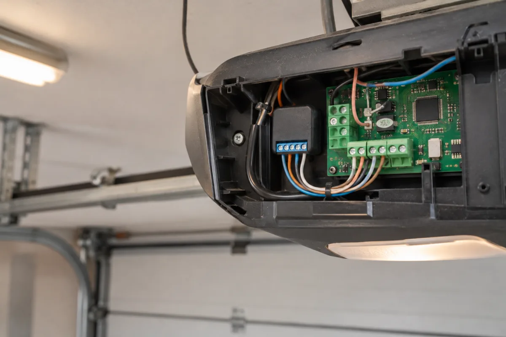
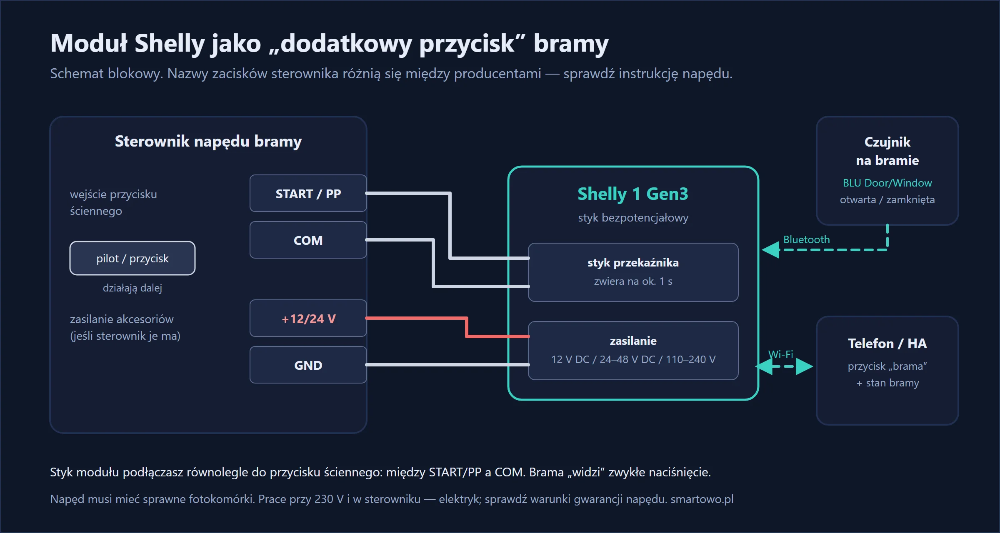
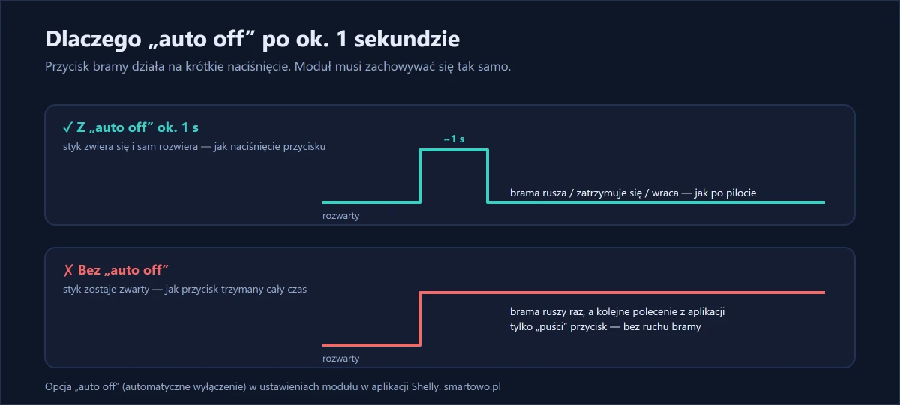

Pilot do bramy zawsze jest tam, gdzie go akurat nie ma: w drugim samochodzie, w kurtce, u dziecka, które wyszło z domu. A czasem po prostu chcesz otworzyć bramę kurierowi albo sprawdzić z pracy, czy na pewno się zamknęła.

Robiłem to przy segmentowej bramie garażowej z typowym napędem sufitowym. Problem był prozaiczny: dwa samochody, jeden sprawny pilot i regularne pytanie na rodzinnym czacie, czy ktoś zamknął garaż.

U siebie bramę wjazdową otwieram inaczej — sama otwiera się, gdy podjeżdżam pod dom. To opisałem w [osobnym wpisie](/blog/brama-otwiera-sie-sama-home-assistant/).

Większość napędów bram ma w sterowniku wejście na dodatkowy przycisk ścienny. Wystarczy podłączyć do niego mały moduł Shelly — i ten moduł „naciska przycisk” na polecenie z telefonu. Do tego czujnik na bramie, żeby widzieć, czy jest otwarta, czy zamknięta.

<!-- ZDJĘCIE 1: brama garażowa i telefon z przyciskiem -->

## W skrócie

- **Shelly 1 Gen3** ma **styk bezpotencjałowy** — działa jak zwykły przycisk podłączony do sterownika bramy.
- Moduł daje **krótki impuls** (ok. 1 sekundy), dokładnie jak naciśnięcie przycisku.
- **Czujnik otwarcia** na bramie pokazuje w telefonie, czy brama jest zamknięta.
- Przycisk „brama” może mieć **cała rodzina** w telefonie, a w Home Assistant — także w samochodzie przez Android Auto / CarPlay czy na zegarku.



## Sprzęt



Do sprawdzania, czy brama jest zamknięta — czujnik otwarcia na baterię:



Czujnik BLU łączy się przez Bluetooth z modułem Shelly 1 Gen3, który przekazuje jego stan do sieci — pod warunkiem, że jest w zasięgu (w pomieszczeniu do ok. 10 m, metalowa brama może go skracać).

W tej realizacji zamontowałem Shelly 1 Gen3 w obudowie napędu i czujnik BLU Door/Window na bramie.

## Zanim zaczniesz: sprawdź sterownik bramy

Wszystko zależy od sterownika napędu. W instrukcji sterownika poszukaj wejścia oznaczonego zwykle jako **START**, **PP** (krok po kroku), **OPEN** albo „przycisk ścienny”. To wejście, do którego producent przewidział podłączenie dodatkowego przycisku — tam podłącza się moduł.

Sprawdź też w instrukcji:

- **zasilanie akcesoriów** (np. 12 V lub 24 V) — jeśli jest, moduł można zasilić bezpośrednio ze sterownika,
- czy wejście działa w trybie **„krok po kroku”** (otwórz → stop → zamknij) — wtedy jeden impuls robi to samo co przycisk na pilocie.

Tutaj sterownik miał wejście przycisku ściennego w trybie krok po kroku i wyjście 24 V na akcesoria — z niego zasiliłem moduł.

{: width="1200" height="800" loading="lazy"}

*Ilustracja wygenerowana przez AI.*

{: width="1200" height="640" loading="lazy"}

## Montaż krok po kroku

> **Uwaga:** praca przy sterowniku napędu, a jeśli moduł zasilasz z 230 V — przy instalacji elektrycznej. Wyłącz zasilanie napędu. Bez uprawnień zleć montaż elektrykowi albo [napisz do mnie](#kontakt). Sprawdź też, czy ingerencja w sterownik nie wpływa na gwarancję napędu.

**1. Wyłącz zasilanie napędu.**

**2. Zasil moduł** — z zasilania akcesoriów sterownika (12 V lub 24 V DC) albo z 230 V, zgodnie ze schematem z instrukcji modułu.

**3. Podłącz styk bezpotencjałowy modułu** (zaciski wyjścia przekaźnika) do wejścia START/PP sterownika i jego wspólnego zacisku (COM/GND) — tak jak podłączyłbyś zwykły przycisk.

**4. Włącz zasilanie i dodaj moduł do aplikacji Shelly.**

**5. Ustaw automatyczne wyłączenie po ok. 1 sekundzie** (w ustawieniach modułu: „auto off”). Dzięki temu moduł daje krótki impuls, jak naciśnięcie przycisku, a nie trzyma wejścia na stałe.

{: width="1200" height="540" loading="lazy"}

**6. Zamontuj czujnik otwarcia** na bramie i ościeżnicy — tak, żeby przy zamkniętej bramie obie części były blisko siebie.

**7. Przetestuj** kilka razy z bramą w zasięgu wzroku.

Najtrudniejszy okazał się zasięg. Metalowa brama tłumiła Bluetooth czujnika na tyle, że przy pierwszym ułożeniu stan odświeżał się z opóźnieniem. Pomogło przesunięcie czujnika na krawędź bramy bliżej napędu. W obudowie sterownika miejsca było na styk, więc przewody trzeba było przyciąć na wymiar.

## Bezpieczeństwo

Brama sterowana z telefonu może ruszyć, gdy nie widzisz, co jest w jej świetle. Dlatego:

- **napęd musi mieć sprawne fotokomórki** i zabezpieczenia, które zatrzymują bramę przy przeszkodzie,
- **czujnik położenia** to podstawa — zawsze widzisz, czy brama jest zamknięta,
- przycisk w aplikacji warto zabezpieczyć **potwierdzeniem**, żeby nie otworzyć bramy przypadkiem.

## Home Assistant: przycisk i powiadomienie

W Home Assistant moduł i czujnik pojawiają się jako osobne encje. Przydatna automatyzacja: powiadomienie, gdy brama jest otwarta dłużej niż 10 minut:

```yaml
- alias: "Brama otwarta za długo"
  triggers:
    - trigger: state
      entity_id: binary_sensor.brama_garazowa
      to: "on"
      for: "00:10:00"
  actions:
    - action: notify.mobile_app_twoj_telefon
      data:
        title: "Brama garażowa"
        message: "Brama jest otwarta od 10 minut."
```

Nazwę `binary_sensor.brama_garazowa` zmień na swoją encję czujnika otwarcia.



## Ile to kosztuje

Moduł i czujnik to razem około 170–200 zł. Podłączenie, konfiguracja i testy zajęły mi około półtorej godziny.

## Efekt po kilku tygodniach

Po kilku tygodniach pilot leży w szufladzie jako zapas. Domownicy otwierają garaż z telefonu, a najczęściej używaną funkcją okazało się nie otwieranie, tylko powiadomienie „brama otwarta od 10 minut” — przyszło kilka razy i za każdym razem słusznie.

## Najczęstsze pytania

**Czy da się sterować z telefonu każdą bramą?**
Prawie każdą, której sterownik ma wejście na przycisk ścienny (START, PP, OPEN). Szczegóły są w instrukcji sterownika napędu.

**Czy pilot dalej będzie działał?**
Tak. Moduł podłącza się równolegle do wejścia przycisku — pilot i przyciski działają jak dotąd.

**Skąd wiem, czy brama się zamknęła?**
Z czujnika otwarcia zamontowanego na bramie. Jego stan widzisz w aplikacji, a w Home Assistant możesz dostać powiadomienie, gdy brama jest otwarta za długo.

**Czym zasilić moduł w garażu?**
Shelly 1 Gen3 według producenta może być zasilany z 110–240 V AC, 24–48 V DC lub 12 V DC. Często najprościej zasilić go z wyjścia akcesoriów sterownika bramy (12 V lub 24 V).
