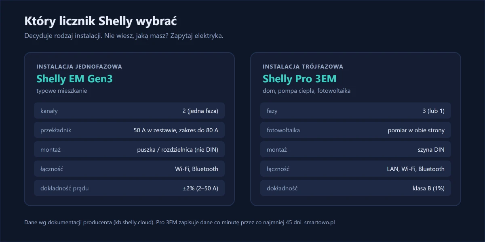
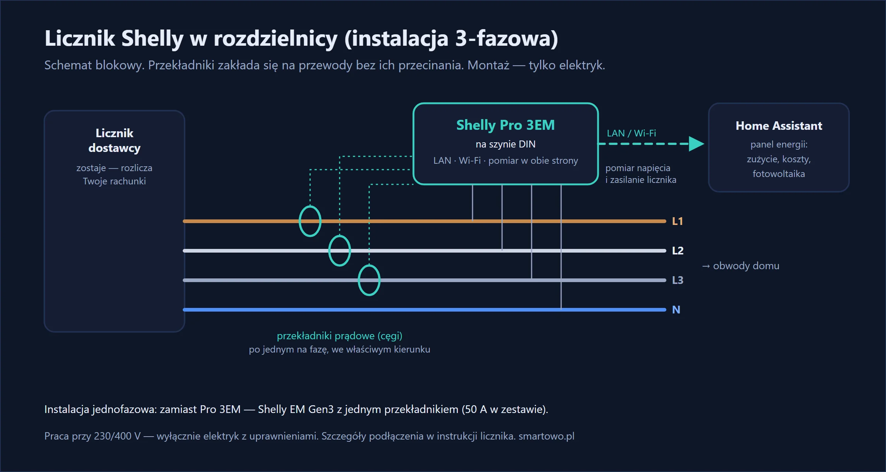
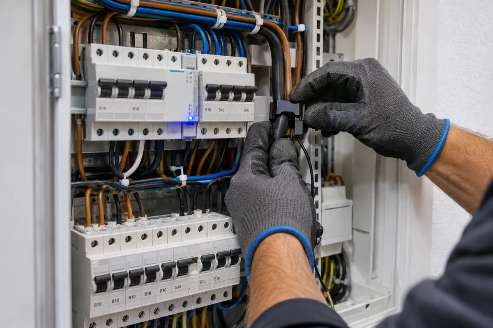

Rachunek za prąd przychodzi raz na jakiś czas i mówi tylko jedno: ile zapłaciłeś. Nie mówi, **co** tyle zużywa — pompa ciepła, bojler, stara zamrażarka w piwnicy, a może urządzenia, które „śpią” całą noc i pobierają prąd bez przerwy.

Montowałem taki licznik w domu jednorodzinnym pod Wrocławiem: instalacja trójfazowa, pompa ciepła, fotowoltaika dopiero w planach. Właściciel chciał wiedzieć dwie rzeczy: ile bierze sama pompa i ile dom zużywa „na pusto” — zanim zdecyduje, jak dużą instalację PV zamówić.

Licznik energii Shelly montowany w rozdzielnicy mierzy zużycie całego domu na żywo. W telefonie widzisz moc w tej chwili, wykres z każdej godziny i dnia — a w Home Assistant pełny panel energii, także z produkcją z fotowoltaiki.

<!-- ZDJĘCIE 1: licznik w rozdzielnicy -->

## W skrócie

- **Licznik Shelly** montuje się w rozdzielnicy — mierzy prąd przez **przekładniki (cęgi)** zakładane na przewody.
- Do instalacji **jednofazowej** — Shelly EM Gen3, do **trójfazowej** — Shelly Pro 3EM.
- Widzisz **zużycie na żywo** i **historię**, a w Home Assistant — panel energii z kosztami.
- Pro 3EM mierzy przepływ energii **w obie strony**, więc nadaje się do instalacji z **fotowoltaiką**.
- Montaż w rozdzielnicy to **praca dla elektryka**.



## Który licznik wybrać

{: width="1200" height="600" loading="lazy"}

**Instalacja jednofazowa** (typowe mieszkanie):



**Instalacja trójfazowa** (typowy dom jednorodzinny, pompa ciepła, fotowoltaika):

{% include produkt.html id="shelly-pro-3em" opis="Trójfazowy licznik energii na szynę DIN, z Wi-Fi i złączem LAN. Mierzy energię w obu kierunkach — gotowy na fotowoltaikę. Według producenta klasa dokładności B (1%) i zapis danych co minutę przez co najmniej 45 dni." %}

Jak sprawdzić, czy masz instalację jednofazową czy trójfazową? Spójrz na bezpiecznik główny przy liczniku od dostawcy prądu: trzy połączone ze sobą „bezpieczniki” obok siebie to zwykle instalacja trójfazowa. Pewność da elektryk.

Tu wybór był prosty: trzy fazy i plany na fotowoltaikę, więc Pro 3EM. Mierzy w obie strony, więc po montażu paneli nie trzeba niczego wymieniać.

## Montaż

> **Uwaga:** montaż w rozdzielnicy to praca przy instalacji 230/400 V. Wykonuje ją wyłącznie elektryk z uprawnieniami. Jeśli mieszkasz we Wrocławiu lub okolicach — [napisz do mnie](#kontakt).

Przekładniki prądowe zakłada się na przewody **bez ich przecinania** — obejmują przewód jak klamra. Licznik potrzebuje dodatkowo podłączenia do napięcia (do pomiaru napięcia i własnego zasilania) — zgodnie ze schematem z instrukcji. Ważne, żeby każdy przekładnik trafił na właściwą fazę i był założony w dobrym kierunku — inaczej pomiar będzie błędny.

{: width="1200" height="640" loading="lazy"}

Montaż zajął około półtorej godziny. Na szynie DIN było wolne miejsce, więc licznik wszedł bez przebudowy rozdzielnicy. Najwięcej uwagi wymagało dopasowanie przekładników do faz: po pierwszym uruchomieniu jedna faza pokazywała moc ujemną, bo przekładnik był założony odwrotnie.

{: width="1200" height="800" loading="lazy"}

*Ilustracja wygenerowana przez AI.*

## Co możesz zobaczyć

**Zużycie „w spoczynku”.** Sprawdź moc w nocy, gdy wszystko jest wyłączone. To, co wtedy widać, pobiera prąd przez całą dobę: router, lodówka, urządzenia w trybie czuwania. Czasem okazuje się, że to więcej, niż się spodziewasz.

**Prądożerne urządzenia.** Włączasz czajnik, bojler albo grzejnik i od razu widzisz skok mocy. Tak najłatwiej sprawdzić, które urządzenie ile naprawdę pobiera.

**Fotowoltaika.** Z licznikiem mierzącym w obie strony widzisz, kiedy oddajesz energię do sieci, a kiedy ją pobierasz — i możesz przesunąć pranie czy grzanie wody na godziny z produkcją.

W tej realizacji największym zaskoczeniem było zużycie w spoczynku: w nocy, przy niepracującej pompie ciepła, dom brał około 350 W. Złożyły się na to m.in. stara zamrażarka w garażu, pompa cyrkulacyjna ciepłej wody pracująca całą dobę i sprzęt RTV w czuwaniu.

<!-- ZDJĘCIE 3: zrzut ekranu panelu energii w Home Assistant -->

## Panel energii w Home Assistant

Licznik Shelly pojawia się w Home Assistant automatycznie. W **Ustawienia → Panele → Energia** wskazujesz:

- encję energii pobranej z sieci (licznik zużycia),
- jeśli masz fotowoltaikę — encję energii oddanej do sieci i produkcji,
- cenę za kWh — wtedy panel liczy też koszty.

Od tego momentu masz wykresy dzienne, tygodniowe i miesięczne, które możesz porównywać z rachunkiem.



## Ile to kosztuje

Sam licznik Pro 3EM z przekładnikami to wydatek rzędu 500–600 zł. Do tego dochodzi montaż w rozdzielnicy i konfiguracja panelu energii — wycenę dla Twojego domu podam po krótkiej rozmowie, [napisz do mnie](#kontakt).

## Efekt po kilku tygodniach

Po kilku tygodniach właściciel ustawił cyrkulację ciepłej wody na harmonogram i wyłączył starą zamrażarkę. Zużycie w spoczynku spadło z około 350 W do około 200 W. Ważniejszy był drugi efekt: decyzję o wielkości fotowoltaiki podejmuje teraz na podstawie własnego wykresu, a nie szacunków.

## Najczęstsze pytania

**Czy licznik Shelly zastępuje licznik od dostawcy prądu?**
Nie. Licznik od dostawcy zostaje i to on jest podstawą rozliczeń. Shelly to dodatkowy pomiar dla Ciebie — pokazuje zużycie na żywo i jego historię.

**Czy mogę zamontować licznik sam?**
Montaż w rozdzielnicy wymaga pracy przy napięciu 230/400 V i powinien go wykonać elektryk z uprawnieniami.

**Czy Shelly mierzy produkcję z fotowoltaiki?**
Shelly Pro 3EM mierzy energię w obu kierunkach (producent określa go jako gotowy na fotowoltaikę), więc widzi zarówno pobór z sieci, jak i oddawanie nadwyżek.

**Jak dokładny jest pomiar?**
Shelly Pro 3EM według producenta ma klasę dokładności B (1%). Shelly EM Gen3 podaje dokładność pomiaru prądu ±2% w zakresie 2–50 A.
