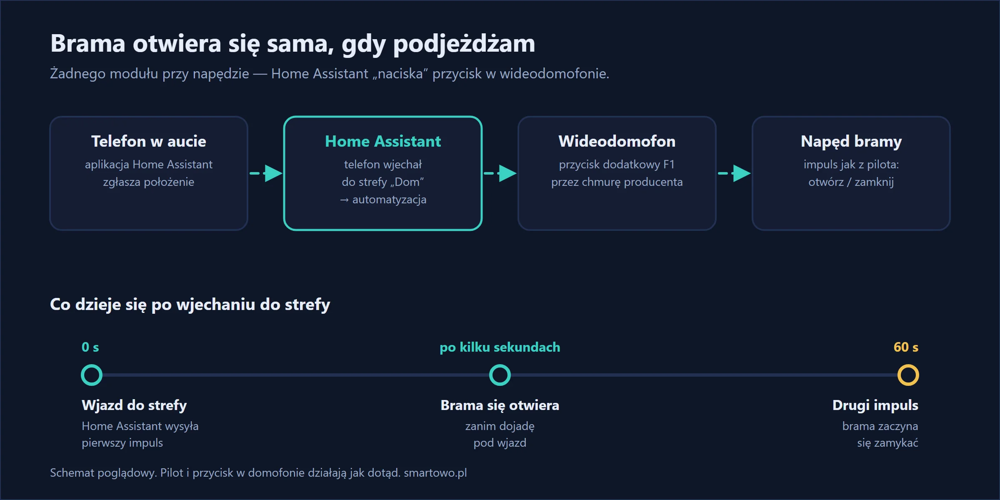
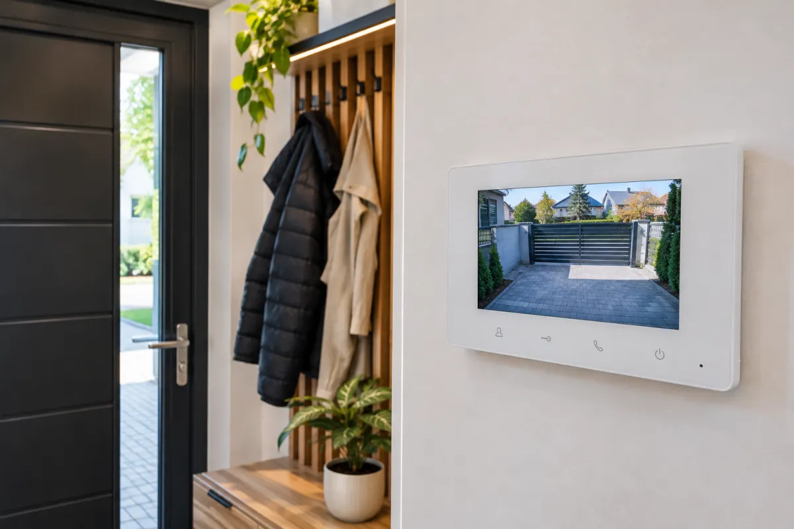

Pilot do bramy to jeden z tych przedmiotów, które zawsze leżą nie tam, gdzie trzeba. A nawet gdy leży w aucie, to i tak trzeba po niego sięgnąć, trafić w przycisk i chwilę poczekać przed wjazdem.

U siebie pozbyłem się tego całkiem. Gdy wracam do domu, brama wjazdowa zaczyna się otwierać, zanim do niej dojadę. Po minucie sama się zamyka. Nie dokupiłem do tego żadnego sprzętu: Home Assistant wie, gdzie jest mój telefon, a bramę otwiera przyciskiem, który i tak mam w wideodomofonie.

## W skrócie

- **Telefon** z aplikacją Home Assistant zgłasza, że wjechałem do strefy „Dom”.
- **Home Assistant** naciska wtedy dodatkowy przycisk **F1** w wideodomofonie — ten sam, którym otwieram bramę z ekranu w przedpokoju.
- Po **60 sekundach** naciska go drugi raz i brama się zamyka.
- **Koszt dodatkowego sprzętu: 0 zł.** Przy samym napędzie niczego nie ruszałem.

{: width="1200" height="600" loading="lazy"}



## Czego użyłem

- **Wideodomofon Fermax VEO-XL WIFI.** Ma przycisk dodatkowy F1, który u mnie steruje bramą wjazdową. Monitor łączy się z internetem, więc bramę da się otworzyć także z aplikacji producenta.
- **Integracja Fermax Blue w Home Assistant.** To nieoficjalna integracja instalowana przez HACS. Po zalogowaniu kontem z aplikacji domofonu w Home Assistant pojawiają się przyciski monitora — w tym F1.
- **Aplikacja Home Assistant na telefonie** z włączonym udostępnianiem lokalizacji.
- **Strefa „Dom”** w Home Assistant, czyli okrąg na mapie wokół domu.

Nie masz takiego domofonu? Nic straconego. Do większości napędów da się podłączyć mały przekaźnik, który robi to samo — opisałem to we wpisie [jak otwierać bramę telefonem](/blog/brama-garazowa-sterowanie-z-telefonu/). Automatyzacja ze strefą zostaje wtedy identyczna, zmienia się tylko to, co „naciska przycisk”.

{: width="1200" height="800" loading="lazy"}

*Ilustracja wygenerowana przez AI — to nie jest mój przedpokój ani mój domofon.*

## Jak to działa krok po kroku

1. Telefon co jakiś czas zgłasza swoje położenie do Home Assistant.
2. Gdy z zewnątrz wjeżdża do strefy „Dom”, uruchamia się automatyzacja.
3. Home Assistant naciska F1 — brama dostaje impuls i zaczyna się otwierać.
4. Po minucie Home Assistant naciska F1 jeszcze raz. Napęd pracuje w trybie krok po kroku, więc drugi impuls zamyka bramę.

Cała sztuka polega na dobraniu **wielkości strefy**. Za mała — brama ruszy dopiero, gdy stoję pod nią. Za duża — otworzy się, gdy jestem jeszcze dwie ulice dalej, albo wtedy, gdy tylko przejeżdżam obok. U mnie sprawdziła się strefa na tyle duża, żeby brama zdążyła się otworzyć w czasie dojazdu ostatnim odcinkiem ulicy.

## Automatyzacja

```yaml
- alias: "Otwarcie bramy po dojeździe"
  triggers:
    - trigger: zone
      entity_id: device_tracker.twoj_telefon
      zone: zone.home
      event: enter
  actions:
    - action: button.press
      target:
        entity_id: button.wideodomofon_f1
    - delay: "00:01:00"
    - action: button.press
      target:
        entity_id: button.wideodomofon_f1
```

Nazwy `device_tracker.twoj_telefon` i `button.wideodomofon_f1` zamień na swoje encje. Jeśli Twój napęd sam zamyka bramę po ustawionym czasie, drugie naciśnięcie usuń — inaczej zatrzymasz albo ponownie otworzysz bramę.

## Na co uważać

Brama, która rusza bez Twojego kliknięcia, wymaga kilku zabezpieczeń:

- **Fotokomórki i zabezpieczenie przed przytrzaśnięciem muszą działać.** Drugi impuls zamyka bramę po minucie niezależnie od tego, czy zdążyłeś wjechać. Jeśli auto stoi w świetle bramy, zatrzymać ją musi napęd, nie automatyzacja.
- **Automatyzacja nie wie, czym wracasz.** Strefa to strefa: brama otworzy się też, gdy wracam pieszo albo rowerem. Mnie to nie przeszkadza, ale warto o tym wiedzieć.
- **To działa przez chmurę producenta domofonu.** Bez internetu albo przy awarii serwerów Fermax automatyzacja nie zadziała. Dlatego pilot dalej leży w aucie jako zapas.
- **Lokalizacja z telefonu bywa spóźniona.** Zdarza się, że telefon zgłosi wjazd z opóźnieniem kilkunastu sekund — wtedy dojeżdżam pod zamkniętą bramę i chwilę czekam.
- **Nieoficjalna integracja może przestać działać** po zmianie po stronie producenta. Traktuję to jako wygodę, nie jako jedyny sposób dostania się na posesję.



## Ile to kosztuje

U mnie nic, bo wideodomofon i Home Assistant już były. Ustawienie integracji i automatyzacji zajęło mi jeden wieczór, a potem jeszcze kilka dni poprawiałem wielkość strefy.

Jeśli Twojej bramy nie da się otworzyć z domofonu, potrzebny będzie przekaźnik przy sterowniku napędu — to wydatek poniżej 100 zł plus montaż.

## Jak to działa w praktyce

Zajrzałem do dziennika Home Assistant: od 31 października do 10 listopada automatyzacja uruchomiła się 30 razy, czyli średnio niecałe trzy razy dziennie. Były dni z jednym otwarciem i takie z pięcioma.

Po kilku tygodniach najbardziej doceniam to wieczorem i w deszczu: podjeżdżam, brama jest już w połowie drogi, wjeżdżam bez zatrzymywania. Pilota nie używałem od dawna.

Co bym poprawił? Automatyzacja reaguje na razie tylko na mój telefon. Dopisanie kolejnych domowników to jedna linijka, ale przy dwóch osobach wracających minutę po sobie drugi impuls pierwszej osoby zamknie bramę przed nosem drugiej. Do tego przyda się czujnik otwarcia bramy — wtedy Home Assistant wie, w jakim stanie jest brama, zamiast liczyć impulsy.

## Najczęstsze pytania

**Czy do automatycznego otwierania bramy potrzebny jest GPS w aucie?**
Nie. Wystarczy telefon z aplikacją Home Assistant i włączoną lokalizacją. Home Assistant sprawdza, czy telefon wjechał do strefy wokół domu.

**Czy brama nie otworzy się, gdy jestem w domu?**
Nie. Automatyzacja reaguje tylko na wjazd do strefy z zewnątrz. Dopóki telefon jest w strefie, nic się nie dzieje.

**Co, jeśli nie mam wideodomofonu z przyciskiem do bramy?**
Wtedy do sterownika napędu podłącza się mały przekaźnik, np. Shelly 1 Gen3. Reszta — strefa i automatyzacja — wygląda tak samo.

**Czy to bezpieczne?**
Tak samo jak pilot, pod warunkiem że napęd ma sprawne fotokomórki, a dostęp do Home Assistant jest zabezpieczony hasłem i dwuetapowym logowaniem. Bramę otwiera Twój telefon w Twojej strefie — nie da się tego wywołać z ulicy.
