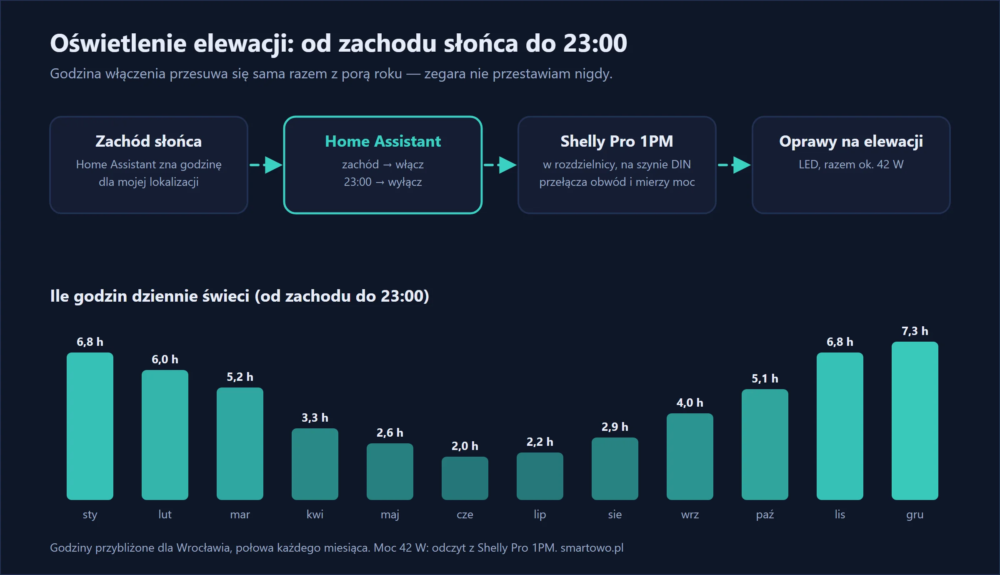

Oświetlenie zewnętrzne ma zwykle jeden z dwóch problemów. Albo steruje nim zegar, który zimą zapala światło za późno, a latem w biały dzień. Albo czujnik zmierzchu, który wariuje od reflektorów, śniegu i własnych lamp.

U siebie zrobiłem to inaczej: lampy na elewacji zapalają się **o zachodzie słońca** i gasną **o 23:00**. Godzina zachodu przesuwa się sama razem z porą roku, więc w grudniu światło zapala się przed 16:00, a w czerwcu po 21:00. Niczego nie przestawiam.

## W skrócie

- **Shelly Pro 1PM** w rozdzielnicy przełącza obwód oświetlenia elewacji i mierzy, ile prądu bierze.
- **Home Assistant** włącza go o zachodzie słońca i wyłącza o 23:00.
- Całe oświetlenie bierze u mnie **około 42 W**.
- Zwykłe włączanie „ręczne” zostaje — z telefonu albo z panelu.

{: width="1200" height="690" loading="lazy"}



## Czego użyłem

Oświetlenie elewacji mam na osobnym obwodzie, więc najprościej było wpiąć sterowanie w rozdzielnicy, zamiast szukać puszki na zewnątrz.

- **Shelly Pro 1PM** — przekaźnik na szynę DIN z pomiarem energii. Ma Wi-Fi i gniazdo LAN, więc w rozdzielnicy nie zależy od zasięgu sieci bezprzewodowej.
- **Home Assistant** — zna godzinę wschodu i zachodu słońca dla lokalizacji domu, bez żadnych dodatkowych czujników.



Jeśli Twoje lampy zewnętrzne są podłączone do zwykłego włącznika w domu, zamiast modułu do rozdzielnicy wystarczy mały moduł w puszce za włącznikiem — tak jak we wpisie o [sterowaniu światłem z telefonu](/blog/sterowanie-swiatlem-z-telefonu-bez-wymiany-wlacznikow/).

## Montaż

> **Uwaga:** montaż w rozdzielnicy to praca przy instalacji 230 V. Wykonuje ją elektryk z uprawnieniami. Jeśli mieszkasz we Wrocławiu lub okolicach — [napisz do mnie](#kontakt).

Moduł zajmuje jedno miejsce na szynie DIN. Wpina się go za zabezpieczeniem obwodu oświetlenia zewnętrznego: zasilanie modułu, faza na wejście przekaźnika, wyjście na przewód do lamp. Dokładny schemat jest w instrukcji modułu.

Po włączeniu zasilania dodajesz moduł do aplikacji Shelly, a Home Assistant wykrywa go sam.

## Automatyzacje

Są dwie i obie mieszczą się w kilku linijkach:

```yaml
- alias: "Elewacja – włącz o zachodzie"
  triggers:
    - trigger: sun
      event: sunset
  actions:
    - action: switch.turn_on
      target:
        entity_id: switch.oswietlenie_elewacji

- alias: "Elewacja – wyłącz o 23:00"
  triggers:
    - trigger: time
      at: "23:00:00"
  actions:
    - action: switch.turn_off
      target:
        entity_id: switch.oswietlenie_elewacji
```

Kilka wariantów, które łatwo dopisać:

- **Wcześniej albo później niż zachód:** dodaj do wyzwalacza `offset: "-00:20:00"`, żeby światło zapaliło się 20 minut przed zachodem.
- **Rano też:** druga para automatyzacji — włącz o 6:00, wyłącz o wschodzie słońca (`event: sunrise`).
- **Do późna w weekend:** warunek dnia tygodnia przy wyłączaniu.

To samo da się ustawić w samej aplikacji Shelly, bez Home Assistant — harmonogramy modułu też obsługują wschód i zachód słońca.

## Ile prądu to bierze

Tu przydaje się pomiar w module. Moje oprawy LED biorą razem około 42 W. Ile godzin dziennie świecą, zależy od pory roku: w grudniu ponad 7 godzin, w czerwcu około 2. Średnio w roku wychodzi mniej więcej 4,5 godziny dziennie.

- 42 W × 4,5 h ≈ **0,19 kWh dziennie**
- około **70 kWh rocznie**
- przy mojej cenie 1,22 zł za kWh to **około 85 zł rocznie**

Gdyby te same lampy świeciły całą noc, wyszłoby mniej więcej trzy razy tyle. Gaszenie o 23:00 nie jest więc tylko kwestią sąsiadów i ciemnej sypialni.

## Ile to kosztuje

Moduł na szynę DIN to wydatek rzędu 250–300 zł. Do tego montaż w rozdzielnicy — u mnie zajął niecałą godzinę razem z konfiguracją, bo obwód elewacji był już wydzielony.

## Efekt po kilku miesiącach

Automatyzacja działa codziennie od dawna i ani razu nie musiałem jej poprawiać. Licznik w module pokazuje 162 kWh od dnia montażu.

Najlepiej widać to jesienią: dni skracają się o kilka minut dziennie, a światło po prostu zapala się coraz wcześniej. Żadnego „znowu trzeba przestawić zegar”.

Po 23:00 elewacja nie jest u mnie całkiem martwa — zapala się na dwie minuty, gdy kamera wykryje człowieka na posesji. To opisałem w [osobnym wpisie](/blog/swiatlo-gdy-kamera-wykryje-czlowieka/).

## Najczęstsze pytania

**Czy do włączania światła o zachodzie potrzebny jest czujnik zmierzchu?**
Nie. Home Assistant i aplikacja Shelly liczą godzinę zachodu słońca z położenia domu. Czujnik przydaje się tylko wtedy, gdy światło ma reagować na pochmurną pogodę, a nie na porę dnia.

**Czy to działa bez Home Assistant?**
Tak. Harmonogram „o zachodzie słońca” ustawisz w aplikacji Shelly. Home Assistant daje więcej możliwości — na przykład połączenie z kamerami albo obecnością domowników.

**Co się stanie, gdy padnie internet?**
Nic. Home Assistant działa lokalnie, a harmonogram zapisany w module działa nawet bez sieci.

**Czy mogę nadal włączyć światło ręcznie?**
Tak — z aplikacji, z panelu Home Assistant albo fizycznym przyciskiem podłączonym do wejścia modułu.
