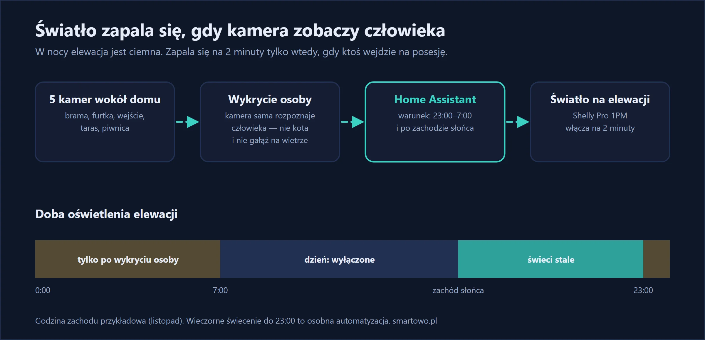

Lampa z czujką ruchu ma jedną wadę: reaguje na wszystko. Kot sąsiadów, gałąź na wietrze, ulewa, przejeżdżające auto — światło zapala się kilkanaście razy w ciągu nocy i po tygodniu nikt już na nie nie patrzy.

Kamery mają tu przewagę, bo potrafią rozpoznać, **co** się rusza. U siebie wykorzystałem to tak: po 23:00 elewacja jest ciemna, ale gdy którakolwiek kamera wykryje człowieka, światło wokół domu zapala się na dwie minuty.

## W skrócie

- **5 kamer** wokół domu: brama, furtka, wejście, taras i zejście do piwnicy.
- Każda zgłasza do Home Assistant osobny sygnał **„wykryto osobę”**.
- Między **23:00 a 7:00** taki sygnał zapala oświetlenie elewacji na **2 minuty**.
- Wieczorem, od zachodu słońca do 23:00, światło i tak świeci stale.

{: width="1200" height="580" loading="lazy"}



## Czego użyłem

- **Kamery UniFi Protect** z wykrywaniem osób. Home Assistant ma do nich oficjalną integrację; każda kamera dostaje czujnik „wykryto osobę”.
- **Oświetlenie elewacji na Shelly Pro 1PM** — ten sam obwód, który wieczorem włącza się o zachodzie słońca. Opisałem go we wpisie o [oświetleniu elewacji](/blog/oswietlenie-elewacji-o-zachodzie-slonca/).
- **Home Assistant**, który łączy jedno z drugim.



Masz inne kamery? Zasada jest ta sama, o ile kamera albo rejestrator potrafi rozpoznać człowieka i przekazać to do Home Assistant. Sprawdź to przed zakupem — zwykłe „wykrycie ruchu” da ten sam efekt co czujka za 30 zł.

## Dlaczego kamera, a nie czujka ruchu

- **Na co reaguje.** Czujka ruchu — na wszystko, co ciepłe i się rusza. Kamera — na sylwetkę człowieka.
- **Koty, ptaki, gałęzie.** Czujkę wyzwalają, kamery z wykrywaniem osób — nie.
- **Zasięg.** Czujka widzi kilka metrów przed sobą. Kamera — cały swój kadr.
- **Koszt.** Czujka to nowe urządzenie przy każdej lampie. Kamery, które już wiszą, nie kosztują nic więcej.

Jeśli kamery już wiszą, to czujniki masz za darmo — trzeba je tylko połączyć ze światłem.

## Automatyzacja

```yaml
- alias: "Elewacja – światło po wykryciu osoby"
  mode: restart
  triggers:
    - trigger: state
      entity_id:
        - binary_sensor.brama_person_detected
        - binary_sensor.furtka_person_detected
        - binary_sensor.wejscie_person_detected
        - binary_sensor.taras_person_detected
        - binary_sensor.piwnica_person_detected
      to: "on"
  conditions:
    - condition: time
      after: "23:00:00"
      before: "07:00:00"
    - condition: sun
      after: sunset
      before: sunrise
  actions:
    - action: switch.turn_on
      target:
        entity_id: switch.oswietlenie_elewacji
    - delay: "00:02:00"
    - action: switch.turn_off
      target:
        entity_id: switch.oswietlenie_elewacji
```

Co tu jest ważne:

- **Dwa warunki naraz.** Godziny 23:00–7:00 i dodatkowo „po zachodzie, przed wschodem”. W czerwcu o 6:00 jest już jasno, więc światło się nie zapali.
- **`mode: restart`.** Jeśli ktoś dalej chodzi po posesji i kamera wykryje go ponownie, dwie minuty liczą się od nowa. To poprawka względem mojej pierwszej wersji, w której kolejne wykrycia w trakcie świecenia były ignorowane.
- **`to: "on"`.** Automatyzacja reaguje tylko na pojawienie się osoby, a nie na zniknięcie sygnału.

Wieczorem ta automatyzacja nic nie robi, bo przed 23:00 światło i tak świeci, a gasi je osobna reguła.

## Na co uważać

- **Opóźnienie.** Kamera potrzebuje chwili, żeby uznać, że to człowiek. Światło zapala się sekundę lub dwie po wejściu w kadr, nie natychmiast.
- **Fałszywe wykrycia zdarzają się rzadko, ale się zdarzają** — zwłaszcza przy deszczu w podczerwieni. Warto w ustawieniach kamer zawęzić strefy wykrywania do własnej posesji, żeby nie reagowały na chodnik.
- **Kamera nie zastąpi światła przy schodach.** Tam, gdzie chodzi o bezpieczeństwo domowników, lepsza jest zwykła czujka, która zapala światło natychmiast.



## Ile to kosztuje

Kamery i sterowanie elewacją już miałem, więc sama automatyzacja nie kosztowała nic — poza godziną na ustawienie i kilkoma nocami testów. Jeśli zaczynasz od zera, największym kosztem są kamery i rejestrator; moduł do oświetlenia to przy nich drobiazg.

## Efekt po kilku tygodniach

Automatyzacja uruchamia się rzadko — i o to chodzi. Ostatni raz zadziałała 8 listopada o 3:48 w nocy. Światło, które zapala się raz na kilka nocy, zwraca uwagę; światło, które miga co kwadrans, nie.

Dla kogoś, kto wchodzi na posesję, efekt jest jednoznaczny: robi krok za furtkę i cały dom się rozświetla. Dla mnie to też wygoda — gdy wracam po 23:00, nie idę do drzwi po ciemku.

Następny krok to powiadomienie ze zdjęciem z kamery na telefon. Sygnał „wykryto osobę” już jest, wystarczy dopisać jedną akcję.

## Najczęstsze pytania

**Czy każda kamera potrafi wykryć człowieka?**
Nie. Potrzebna jest kamera albo rejestrator z rozpoznawaniem osób, który przekazuje tę informację do Home Assistant. Samo wykrywanie ruchu reaguje na wszystko.

**Czy światło zapali się na kota?**
Przy wykrywaniu osób — zwykle nie. To główna przewaga nad czujką ruchu.

**Czy to działa bez internetu?**
U mnie tak. Kamery, rejestrator i Home Assistant pracują w sieci domowej, więc wykrycie i zapalenie światła nie przechodzą przez chmurę.

**Czy mogę dostać też powiadomienie na telefon?**
Tak. W tej samej automatyzacji można dodać powiadomienie, także ze zdjęciem z kamery, która wykryła osobę.
