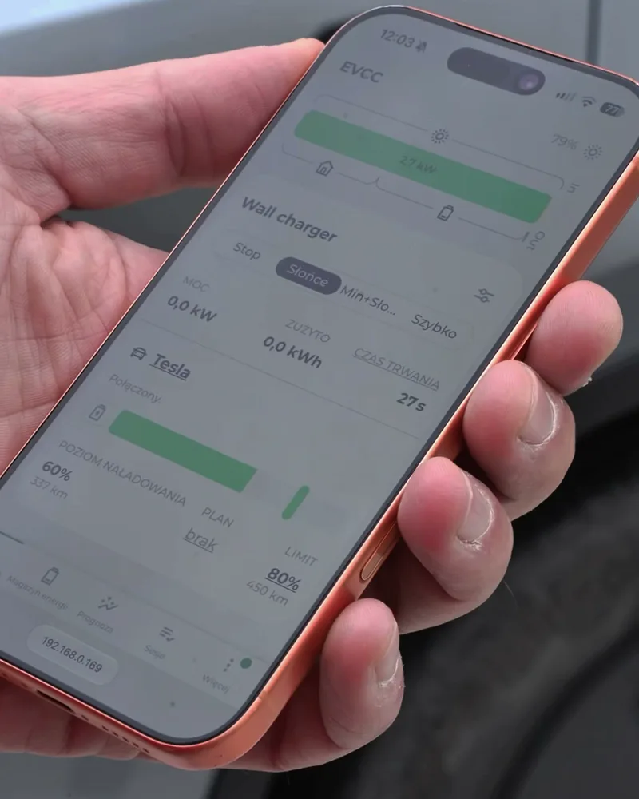
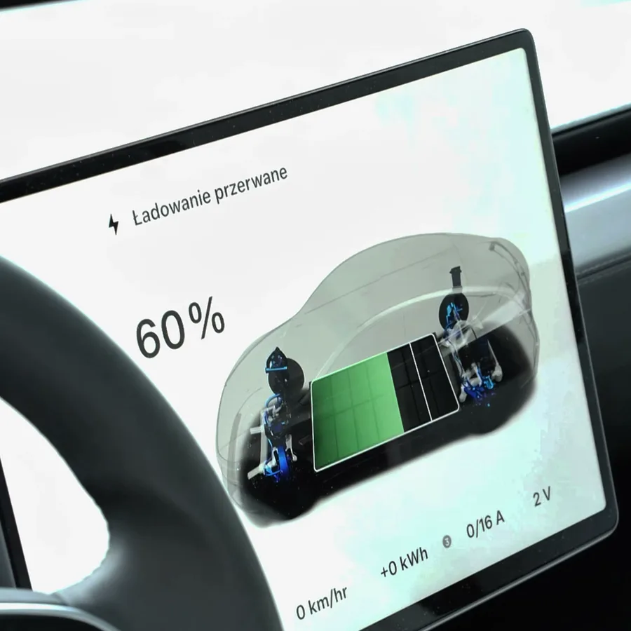

Fotowoltaika i samochód elektryczny pasują do siebie tylko w teorii. W praktyce auto podłączasz wieczorem, kiedy słońca już nie ma, a w południe — kiedy dach produkuje najwięcej — nadwyżki idą do sieci za grosze. U mnie sprzedaż kilowatogodziny to około 12 groszy, a zakup 1,22 zł. Różnica jest dziesięciokrotna.

Dlatego ładowaniem steruje u mnie nie samochód i nie ładowarka, tylko program, który widzi cały dom: produkcję z dachu, zużycie, magazyn energii i auto.

## W skrócie

- **evcc** — darmowy program, który co chwilę liczy nadwyżkę energii i ustawia prąd ładowania auta tak, żeby ją zużyć.
- **Tryb „słońce”** jest domyślny: auto ładuje się tylko z nadwyżek.
- **Automatyzacja w Home Assistant** pilnuje terminu: jeśli prognoza mówi, że słońca do jutra nie wystarczy, przełącza na szybkie ładowanie.
- Wynik po 38 sesjach: **39% energii w aucie pochodzi z dachu**, a średni koszt to **0,74 zł/kWh** zamiast 1,22 zł.

{: width="1200" height="630" loading="lazy"}



## Czego użyłem

- **Falownik hybrydowy Sofar z magazynem energii 10 kWh.** Do Home Assistant podłączony lokalnie, przez integrację Solarman.
- **Tesla Wall Connector** — ładowarka ścienna, trzy fazy.
- **evcc** — otwarty program do sterowania ładowaniem. Działa obok Home Assistant i obsługuje bardzo dużo falowników, ładowarek i aut.
- **Integracja evcc w Home Assistant** (z HACS) — dzięki niej tryb ładowania i wszystkie liczby widać w Home Assistant i można nimi sterować z automatyzacji.

Ważne: evcc sam z siebie w zupełności wystarcza do ładowania z nadwyżek. Home Assistant dokładam po to, żeby ładowanie reagowało także na prognozę pogody.

## Jak evcc ładuje z nadwyżek

W trybie „słońce” evcc robi w kółko jedno: sprawdza, ile energii zostaje po odjęciu zużycia domu, i ustawia prąd ładowania auta tak, żeby zużyć właśnie tyle. Gdy chmura zasłoni słońce — zmniejsza prąd. Gdy nadwyżka znika — przerywa.

{: width="400" height="500" loading="lazy"}

Kilka ustawień, które u mnie się sprawdziły:

- **Prąd ładowania 6–16 A.** Sześć amperów to minimum, od którego auto w ogóle zaczyna ładować.
- **Start po 2 minutach nadwyżki, stop po 15 minutach jej braku.** Bez tego ładowanie włączałoby się i wyłączało przy każdej chmurze.
- **Limit ładowania 80%.** Na co dzień nie potrzebuję więcej, a bateria auta to lubi.
- **Magazyn energii ma pierwszeństwo do 50%.** Najpierw ładuje się magazyn domowy, potem auto — żeby wieczorem dom nie ciągnął z sieci.

{: width="600" height="600" loading="lazy"}

*Tak wygląda przerwa od strony auta: samochód zostaje podłączony i czeka, aż evcc znów puści prąd.*

## Problem: listopad

Latem to wystarcza. Zimą dach daje ułamek tego co w czerwcu i w trybie „słońce” auto mogłoby stać podłączone trzy dni i nie doładować się wcale.

Dopisałem więc automatyzację, która przy każdym podłączeniu auta odpowiada na jedno pytanie: **czy do jutra słońce da tyle energii, ile brakuje w baterii?**

Potrzebuje do tego trzech liczb:

1. **Ile energii brakuje** — z aktualnego poziomu naładowania, limitu 80% i pojemności baterii (82 kWh).
2. **Ile słońca będzie do terminu** — z prognozy produkcji, pomniejszonej o typowe zużycie domu w ciągu dnia (u mnie przyjmuję 1900 W).
3. **Termin** — ustawiam go automatycznie na 24 godziny od podłączenia auta.

Jeśli pierwsza liczba jest większa od drugiej, Home Assistant przełącza evcc w tryb szybki i auto ładuje się od razu, pełną mocą, także z sieci. Jeśli słońca wystarczy — zostaje tryb „słońce”.

## Automatyzacja

Liczenie energii siedzi u mnie w osobnych czujnikach pomocniczych; sama automatyzacja jest prosta. Poniżej jej sedno, bez dodatków:

```yaml
- alias: "EV – szybkie ładowanie przy słabym słońcu"
  triggers:
    - trigger: state
      entity_id: binary_sensor.ev_slonca_za_malo
      to: "on"
      for: "00:02:00"
    - trigger: time_pattern
      minutes: "/15"
  conditions:
    - condition: state
      entity_id: binary_sensor.wallbox_auto_podlaczone
      state: "on"
    - condition: state
      entity_id: select.wallbox_tryb
      state: "pv"
    - condition: state
      entity_id: binary_sensor.ev_slonca_za_malo
      state: "on"
  actions:
    - action: select.select_option
      target:
        entity_id: select.wallbox_tryb
      data:
        option: "now"

- alias: "EV – po odłączeniu wróć do trybu słońce"
  triggers:
    - trigger: state
      entity_id: binary_sensor.wallbox_auto_podlaczone
      from: "on"
      to: "off"
      for: "00:01:00"
  conditions:
    - condition: state
      entity_id: select.wallbox_tryb
      state: "now"
  actions:
    - action: select.select_option
      target:
        entity_id: select.wallbox_tryb
      data:
        option: "pv"
```

`pv` i `now` to nazwy trybów w evcc: „tylko słońce” i „ładuj teraz”. `binary_sensor.ev_slonca_za_malo` to mój czujnik pomocniczy, który porównuje brakującą energię z prognozą.

Druga automatyzacja jest równie ważna co pierwsza. Bez niej tryb szybki zostałby włączony na stałe i przy następnym, słonecznym dniu auto naładowałoby się z sieci.

## Jak to działa w praktyce

Przykład z 10 listopada. Podłączyłem auto po południu, przy pochmurnej pogodzie. W dzienniku Home Assistant pojawił się wpis:

> tryb szybki: potrzeba 31,9 kWh, słońce do terminu da 0,0 kWh

Ładowanie ruszyło od razu. Auto przyjęło 25,6 kWh w 2 godziny i 16 minut; po odłączeniu tryb sam wrócił na „słońce”. Ta sesja kosztowała 31,24 zł, w całości z sieci — w listopadzie inaczej się nie da.

Ciekawszy jest obraz całości. evcc prowadzi statystyki wszystkich sesji:

- **38 sesji ładowania**, razem **422 kWh**,
- **39% tej energii pochodziło z fotowoltaiki** (166 kWh),
- łączny koszt **312 zł**, czyli średnio **0,74 zł za kWh** przy cenie z sieci 1,22 zł.

Te liczby obejmują już jesień. W samym sezonie letnim udział słońca jest wyraźnie wyższy.



## Ile to kosztuje

evcc i integracje są darmowe (evcc ma płatny wariant dla części urządzeń — sprawdź swoją ładowarkę na liście). Potrzebny jest komputer, na którym to działa; u mnie to ten sam serwer co Home Assistant.

Najwięcej kosztuje czas: podłączenie falownika, ładowarki i auta do evcc zajęło mi dwa wieczory, a automatyzację z prognozą dopracowywałem jeszcze przez kilka dni.

## Na co uważać

- **Nie każdy zestaw falownik + ładowarka da się połączyć.** Przed zakupem wallboxa sprawdź, czy jest na liście urządzeń evcc. Większość popularnych jest.
- **Prognoza słońca to prognoza.** Bywa, że zapowiadane słońce nie przychodzi. Dlatego automatyzacja sprawdza sytuację co 15 minut, a nie tylko w chwili podłączenia.
- **Ładowanie jednofazowe i trójfazowe.** Na trzech fazach minimum to około 4 kW — mała instalacja PV rzadko daje taką nadwyżkę. Część ładowarek potrafi przełączać się na jedną fazę i wtedy wystarcza około 1,4 kW.

## Najczęstsze pytania

**Czy do ładowania z nadwyżek potrzebny jest Home Assistant?**
Nie. Sam evcc potrafi ładować auto z nadwyżek fotowoltaiki. Home Assistant przydaje się do dodatkowej logiki, na przykład reagowania na prognozę pogody.

**Czy potrzebny jest magazyn energii?**
Nie. Magazyn pomaga wykorzystać więcej własnej energii wieczorem, ale ładowanie auta z nadwyżek działa także bez niego.

**Jaka ładowarka nadaje się do ładowania z fotowoltaiki?**
Taka, którą da się sterować z zewnątrz — zmieniać prąd ładowania w trakcie. Lista obsługiwanych modeli jest na stronie evcc.

**Ile można zaoszczędzić?**
To zależy od wielkości instalacji i tego, kiedy auto stoi pod domem. U mnie po 38 sesjach średni koszt energii w aucie to 0,74 zł za kWh zamiast 1,22 zł.
