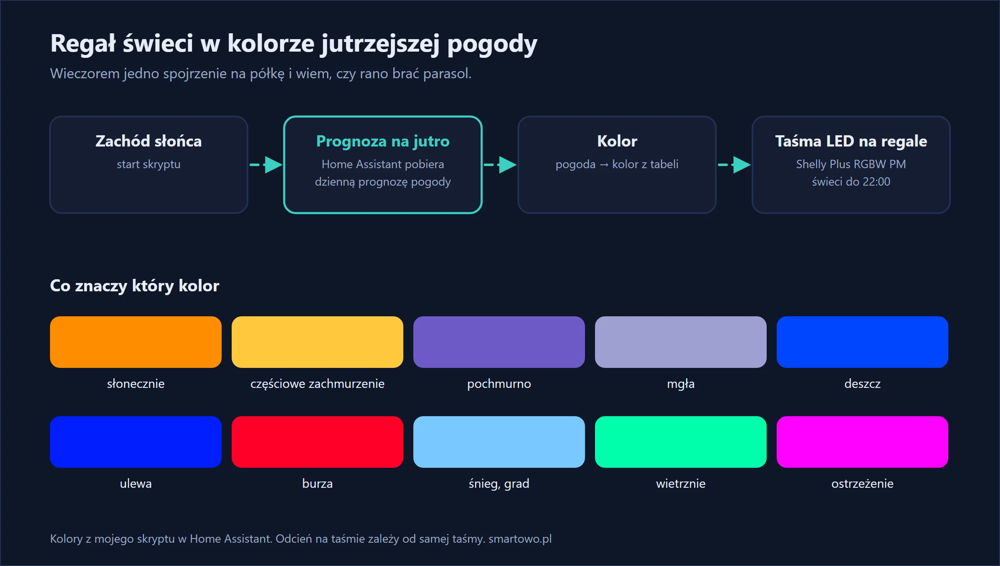

Smart home kojarzy się z oszczędzaniem i bezpieczeństwem, ale czasem najfajniejsze są rzeczy zupełnie niepoważne. To jedna z nich — i jednocześnie automatyzacja, z której korzystam codziennie.

Na regale w salonie mam taśmę LED. Od zachodu słońca do 22:00 świeci w kolorze, który odpowiada **prognozie pogody na jutro**. Nie wyciągam telefonu, nie pytam asystenta głosowego. Wystarczy, że przechodzę obok.

## W skrócie

- **Taśma LED RGBW** na regale, sterowana przez **Shelly Plus RGBW PM**.
- O **zachodzie słońca** Home Assistant pobiera prognozę na jutro i zapala taśmę w odpowiednim kolorze.
- O **22:00** taśma gaśnie.
- Dziesięć kolorów: od pomarańczowego (słońce) po czerwony (burza).

{: width="1200" height="680" loading="lazy"}

## Czego użyłem



Do tego:

- **taśma LED RGBW 12 V lub 24 V** — z czwartym, białym kanałem. Zwykła RGB też zadziała, tylko „biały” będzie mieszany z trzech kolorów;
- **zasilacz** dopasowany do napięcia i długości taśmy;
- **integracja pogody** w Home Assistant. U mnie to domyślna prognoza Met.no, która jest w każdej instalacji od początku.

Krótki odcinek taśmy na regale bierze u mnie około 5 W, więc koszt prądu jest pomijalny.

## Montaż

> **Uwaga:** sterownik pracuje na niskim napięciu (12–24 V), ale zasilacz podłącza się do 230 V. Jeśli nie masz gotowego zasilacza z wtyczką, podłączenie zleć elektrykowi.

1. **Przyklej taśmę** pod półkami albo za krawędzią regału — tak, żeby widać było poświatę, a nie pojedyncze diody. Najlepiej w profilu aluminiowym z mleczną osłoną.
2. **Podłącz taśmę do sterownika:** wspólny plus i cztery kanały (R, G, B, W) zgodnie z oznaczeniami na taśmie i w instrukcji sterownika.
3. **Podłącz zasilacz** do sterownika i sprawdź, czy napięcie zgadza się z taśmą.
4. **Dodaj sterownik do aplikacji Shelly** i wybierz profil RGBW. Home Assistant wykryje go sam jako światło z wyborem koloru.

## Skrypt: prognoza → kolor

Całą robotę wykonuje jeden skrypt. Pobiera dzienną prognozę, wyszukuje wpis na jutro i zamienia stan pogody na kolor.


```yaml
regal_led_prognoza:
  alias: "Regał LED: kolor wg prognozy na jutro"
  sequence:
    - action: weather.get_forecasts
      target:
        entity_id: weather.forecast_home
      data:
        type: daily
      response_variable: prognoza
    - variables:
        wpisy: "{{ prognoza['weather.forecast_home'].forecast | default([]) }}"
        jutro: "{{ (now() + timedelta(days=1)).date() | string }}"
        stan: >-
          
          
            
              
            
          
          {{ ns.c if ns.c is not none else 'brak' }}
        kolor: >-
          {% set m = {
            'sunny': [255,140,0,0],
            'clear-night': [255,140,0,0],
            'partlycloudy': [255,200,60,40],
            'cloudy': [110,90,200,50],
            'fog': [160,160,210,120],
            'rainy': [0,70,255,0],
            'pouring': [0,30,255,0],
            'lightning': [255,0,40,0],
            'lightning-rainy': [255,0,40,0],
            'snowy': [120,200,255,255],
            'snowy-rainy': [120,200,255,255],
            'hail': [120,200,255,255],
            'windy': [0,255,170,0],
            'windy-variant': [0,255,170,0],
            'exceptional': [255,0,255,0]
          } %}
          {{ m.get(stan, [255,255,255,255]) }}
    - action: light.turn_on
      target:
        entity_id: light.regal_led
      data:
        brightness: 255
        rgbw_color: "{{ kolor }}"
```


Każdy kolor to cztery liczby: czerwony, zielony, niebieski i biały, każda od 0 do 255. Jeśli prognozy nie da się pobrać, taśma zapala się na biało — od razu widać, że coś jest nie tak.

Kolory dobierałem na oko, przy samej taśmie. Ta sama liczba na dwóch różnych taśmach da inny odcień, więc potraktuj tabelę jako punkt wyjścia.

## Automatyzacja: kiedy świecić


```yaml
- alias: "Regał LED: zachód słońca → 22:00"
  triggers:
    - trigger: sun
      event: sunset
      id: start
    - trigger: time
      at: "22:00:00"
      id: stop
  actions:
    - choose:
        - conditions:
            - condition: trigger
              id: start
          sequence:
            - action: script.regal_led_prognoza
        - conditions:
            - condition: trigger
              id: stop
          sequence:
            - action: light.turn_off
              target:
                entity_id: light.regal_led
```


Jedna automatyzacja z dwoma wyzwalaczami: zachód słońca uruchamia skrypt, a 22:00 gasi taśmę.



## Ile to kosztuje

- sterownik Shelly Plus RGBW PM: około 100–130 zł,
- taśma LED RGBW z profilem i zasilaczem: 100–200 zł, zależnie od długości i jakości.

Razem 200–350 zł. Montaż taśmy i sterownika zajął mi jedno popołudnie, a skrypt — jeden wieczór, głównie na dobieranie kolorów.

## Efekt po kilku tygodniach

To jedna z tych automatyzacji, które goście zauważają pierwsze. Domownicy nauczyli się kolorów w kilka dni: pomarańczowy i żółty to „bierz okulary”, niebieski to „bierz parasol”, fioletowy to „będzie szaro”. W listopadzie regał jest głównie fioletowy.

Prognoza na następny dzień nie zawsze się sprawdza, ale to już pretensje do meteorologów, nie do taśmy.

Co można dopisać: pulsowanie przy ostrzeżeniach pogodowych, osobny kolor na mróz poniżej zera (skrobanie szyb!) albo poranne powtórzenie koloru przed wyjściem z domu.

## Najczęstsze pytania

**Skąd Home Assistant bierze prognozę pogody?**
Z integracji pogody. Domyślna (Met.no) jest darmowa i dostępna od razu po instalacji; można też użyć innych źródeł.

**Czy to zadziała ze zwykłą taśmą RGB?**
Tak. W skrypcie wystarczy użyć trzech liczb i atrybutu `rgb_color` zamiast `rgbw_color`.

**Czy sterownik Shelly obsłuży długą taśmę?**
Shelly Plus RGBW PM ma ograniczenie prądu na kanał — sprawdź w instrukcji sterownika i porównaj z poborem swojej taśmy. Na regał czy podświetlenie szafek wystarcza z dużym zapasem.

**Czy taśma może służyć też jako zwykłe światło?**
Oczywiście. To zwykłe światło w Home Assistant — można je włączyć ręcznie, dodać do scen i ustawić dowolny kolor.
