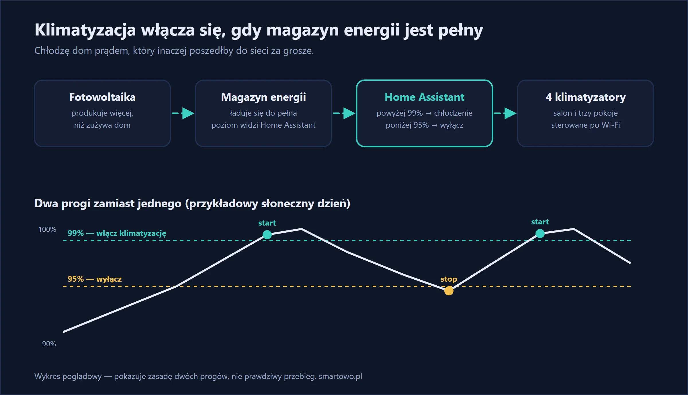

Upał i fotowoltaika mają jedną wspólną cechę: przychodzą razem. Właśnie wtedy, gdy klimatyzacja jest najbardziej potrzebna, dach produkuje najwięcej. Problem w tym, że w dzień często nikogo nie ma w domu, więc klimatyzacja stoi, a nadwyżki energii płyną do sieci po kilkanaście groszy za kilowatogodzinę. Wieczorem wracasz do nagrzanego domu i chłodzisz go prądem po 1,22 zł.

U siebie odwróciłem tę kolejność. Home Assistant patrzy na magazyn energii: gdy jest pełny, włącza klimatyzację. Gdy magazyn zaczyna się rozładowywać — wyłącza ją.

## W skrócie

- **Magazyn energii naładowany powyżej 99%** → włącz chłodzenie we wszystkich czterech klimatyzatorach.
- **Magazyn poniżej 95%** → wyłącz.
- Dom chłodzi się **w ciągu dnia z nadwyżek**, a wieczorem trzyma temperaturę jak termos.
- Zimą automatyzacje są wyłączone jednym przełącznikiem.

{: width="1200" height="690" loading="lazy"}



## Czego użyłem

- **Cztery klimatyzatory Gree** z Wi-Fi — w salonie i trzech pokojach. Home Assistant ma do nich oficjalną integrację, która działa lokalnie, bez chmury producenta.
- **Falownik hybrydowy Sofar z magazynem 10 kWh**, podłączony do Home Assistant przez integrację Solarman. Najważniejszy jest tu jeden czujnik: poziom naładowania magazynu w procentach.
- **Home Assistant**, który łączy jedno z drugim.

Nie masz magazynu energii? Ten sam pomysł działa na czujniku nadwyżki — mocy oddawanej do sieci. Piszę o tym niżej.

## Dlaczego magazyn, a nie moc z dachu

Najprostszy pomysł to: „włącz klimatyzację, gdy panele produkują dużo”. Kłopot w tym, że produkcja skacze z każdą chmurą, a klimatyzacja nie lubi włączania i wyłączania co pięć minut.

Poziom naładowania magazynu rozwiązuje to sam z siebie:

- **pełny magazyn** oznacza, że dom ma już wszystko, czego potrzebuje, i każda kolejna kilowatogodzina idzie do sieci,
- magazyn działa jak **bufor**: gdy chmura zasłoni słońce, klimatyzacja przez chwilę bierze z niego, a po powrocie słońca magazyn się uzupełnia,
- **dwa różne progi** (99% i 95%) sprawiają, że klimatyzacja nie przełącza się co chwilę. Te 5% z magazynu 10 kWh to około 0,5 kWh zapasu — tyle klimatyzacja może „pożyczyć”, zanim automatyzacja uzna, że słońca jest za mało.

## Automatyzacje

```yaml
- alias: "Klimatyzacja – włącz przy pełnym magazynie"
  triggers:
    - trigger: numeric_state
      entity_id: sensor.magazyn_energii_soc
      above: 99
  actions:
    - action: climate.set_hvac_mode
      target:
        entity_id:
          - climate.klimatyzacja_salon
          - climate.klimatyzacja_sypialnia
          - climate.klimatyzacja_pokoj_1
          - climate.klimatyzacja_pokoj_2
      data:
        hvac_mode: cool

- alias: "Klimatyzacja – wyłącz, gdy magazyn się rozładowuje"
  triggers:
    - trigger: numeric_state
      entity_id: sensor.magazyn_energii_soc
      below: 95
  actions:
    - action: climate.set_hvac_mode
      target:
        entity_id:
          - climate.klimatyzacja_salon
          - climate.klimatyzacja_sypialnia
          - climate.klimatyzacja_pokoj_1
          - climate.klimatyzacja_pokoj_2
      data:
        hvac_mode: "off"
```

Nazwy encji zamień na swoje. Automatyzacja włącza tylko tryb chłodzenia; temperatura zostaje taka, jaka była ostatnio ustawiona na pilocie albo w aplikacji.

Co warto dopisać, zanim zostawisz to bez nadzoru:

- **Warunek temperatury** — nie chłodź, gdy w domu jest już 22 °C. Wystarczy warunek na czujniku temperatury w salonie.
- **Warunek pory roku albo temperatury na zewnątrz** — żeby w słoneczny marcowy dzień klimatyzacja nie zaczęła chłodzić. Ja po prostu wyłączam obie automatyzacje na zimę.
- **Wersja bez magazynu:** zamiast poziomu naładowania użyj mocy oddawanej do sieci, z czasem oczekiwania — na przykład „powyżej 1500 W przez 10 minut → włącz”, „pobór z sieci przez 10 minut → wyłącz”.



## Ile to kosztuje

Jeśli klimatyzatory mają Wi-Fi, a falownik jest już w Home Assistant — nic. Obie automatyzacje to kwadrans pracy. Więcej czasu zajmuje wcześniejsze podłączenie falownika, bo każdy producent robi to po swojemu.

Starszy klimatyzator bez Wi-Fi też da się podłączyć — przez pilota na podczerwień sterowanego z Home Assistant.

## Jak to działa w praktyce

Weźmy 16 sierpnia. Magazyn doszedł do pełna o 12:22 i w tym momencie włączyły się wszystkie cztery klimatyzatory. Chłodziły do 17:08, kiedy słońce zeszło niżej i magazyn spadł poniżej 95%. Prawie pięć godzin chłodzenia całego domu bez pobierania prądu z sieci.

Po takim dniu wieczorem w domu jest chłodno, a magazyn — wciąż prawie pełny — zasila dom do nocy.

Uczciwie o wadach:

- Automatyzacja chłodzi **cały dom naraz**. To proste, ale nie zawsze potrzebne; rozsądniej byłoby sterować pokojami osobno, według temperatury.
- Próg wyłączenia jest wysoki, więc przy zmiennym zachmurzeniu klimatyzacja potrafi wyłączyć się wcześniej, niż bym chciał.
- To rozwiązanie na lato. Od jesieni obie automatyzacje są u mnie wyłączone — w listopadzie magazyn rzadko dobija do pełna, a chłodzić i tak nie ma czego.

## Najczęstsze pytania

**Czy klimatyzacja może działać tylko z fotowoltaiki?**
W słoneczny dzień — w dużej mierze tak. Typowy klimatyzator pokojowy bierze kilkaset watów do około 1 kW, a instalacja PV latem produkuje wielokrotnie więcej. Kluczowe jest, żeby chłodzić wtedy, gdy jest produkcja.

**Czy potrzebny jest magazyn energii?**
Nie. Bez magazynu automatyzację opiera się na mocy oddawanej do sieci. Magazyn tylko wygładza chwilowe spadki produkcji.

**Jakie klimatyzatory działają z Home Assistant?**
Większość modeli z Wi-Fi ma integrację — oficjalną albo społecznościową. Modele bez Wi-Fi można sterować przez nadajnik podczerwieni.

**Czy opłaca się chłodzić pusty dom?**
Jeśli alternatywą jest oddanie energii do sieci za kilkanaście groszy i chłodzenie wieczorem prądem z sieci — tak. Dom schłodzony w dzień nagrzewa się wolniej i wieczorem klimatyzacja ma mniej pracy.
